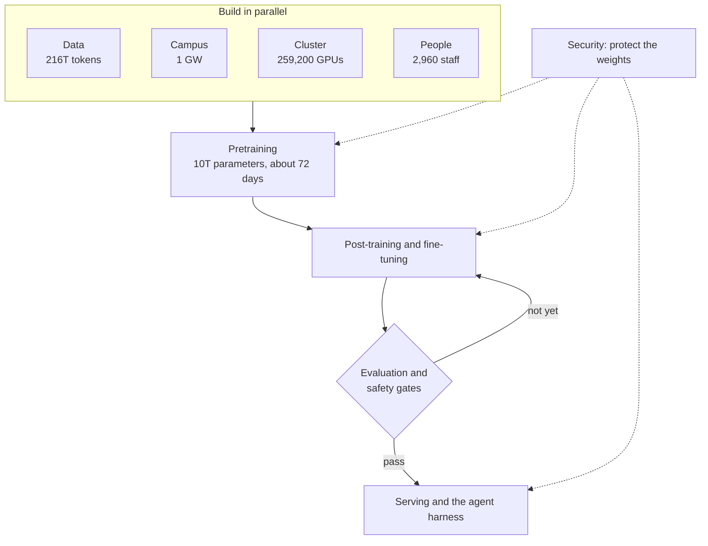
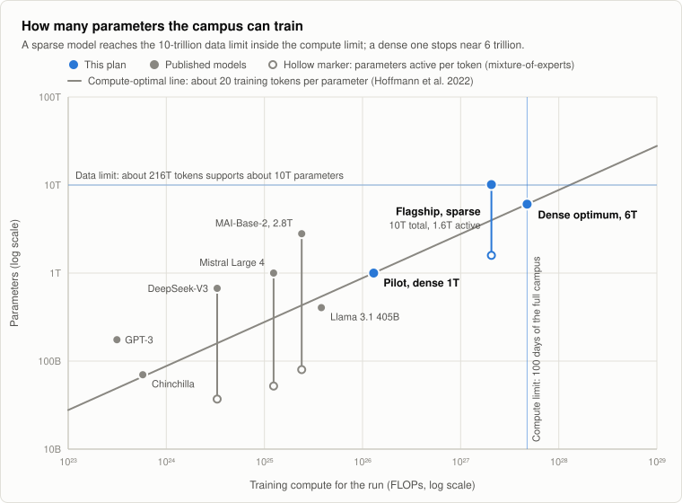

# Theoretical LLM

A paper plan for building a frontier large language model starting from nothing: the data, the model, the GPUs, the campus that powers and cools them, the training run, the fine-tuning, the guardrails, the people, the money and the schedule.

> [!IMPORTANT]
> This is a thought experiment. Nothing here was scraped, bought, built, trained or run. Every figure is a planning estimate. Facts about real hardware, real data centers and real models were researched on 21 November 2026 and are listed in [chapter 19](docs/19-sources.md); everything else is this plan's own design and arithmetic, reproducible with [`calc/sizing.py`](calc/sizing.py).

## The plan at a glance

| Question | Answer |
|---|---|
| How many parameters? | **About 10 trillion** as a sparse model (1.6 trillion active per token). About 6 trillion if dense. The largest count disclosed for any released model today is 2.8 trillion |
| What limits it? | Data, not GPUs. About 216 trillion training tokens is the most that can realistically be assembled |
| Hardware | 3,600 NVIDIA Vera Rubin NVL72 racks: 259,200 GPUs, 74.6 PB of GPU memory |
| Headline compute | 9.07 billion teraFLOPS (the vendor's 4-bit peak) |
| Real training compute | 648 million teraFLOPS sustained: 7% of the headline |
| Training throughput | About 41 million tokens per second during the flagship run |
| Flagship pretraining | 2.1e27 FLOPs: about 72 days on 60% of the campus |
| Campus | 1 GW of IT load in 8 halls on about 1,000 acres; 1.15 GW average draw, 1.3 GW nameplate |
| Energy | 10.1 TWh a year at full load: about 930,000 US homes |
| Cooling | Closed-loop liquid at 45 °C, about 24 m³ of coolant a second, about 700 dry coolers, near-zero water use |
| Network | 1.6 Tbit/s per GPU; 8-plane, two-tier Ethernet; 3,048 switch chassis; about 2 million fiber pairs |
| Storage | 60 PB flash, 410 PB object store; one checkpoint is 20 TB (100 TB with optimizer state) |
| Speed when serving | About 90 tokens per second per user; about 119,000 per rack |
| Cost to serve | About $1.50 of hardware per million output tokens |
| People | About 2,960 staff; about 6,000 construction workers at peak; 10,000 to 30,000 contract annotators and experts |
| Money | $58B to build the campus; $70B in total to launch; $7B a year to run |
| Time | 32 months best case, 38 to 46 realistically. A first small working model at month 9 |
| Guardrails | Six layers: policy, data filtering, training, run-time classifiers, platform enforcement, evaluation gates. Security underneath all of them |

## How it fits together



## Four things the exercise turned up

1. **Vendor teraflops are not training teraflops.** The headline is one matrix multiply at 4-bit precision. Real training runs sustain a small fraction of it. This plan uses 2.5 petaFLOPS per GPU against a headline of 35, and explains why in [chapter 5](docs/05-compute-cluster.md).
2. **Data runs out before GPUs do.** The campus could push more arithmetic than there are useful tokens to spend it on. That is why the model is sparse and why so much compute goes to reinforcement learning instead of a bigger base model ([chapter 4](docs/04-model-and-parameters.md)).
3. **The famous training run is about 2% of the cost and three months of the schedule.** Power is what sets the date; people cost four times as much as electricity ([chapters 15](docs/15-budget.md) and [16](docs/16-timeline.md)).
4. **Guardrails are a system, and they include being willing to stop.** In 2026 real labs paused training, restricted releases and saw a model export-controlled. A plan this size has to assume the same decisions ([chapter 10](docs/10-safety-guardrails-and-refusals.md)).

<picture>
  <source media="(prefers-color-scheme: dark)" srcset="diagrams/parameters-vs-compute-dark.svg">
  
</picture>

## Chapters

| # | Chapter | What it answers |
|---|---|---|
| 1 | [Scope and assumptions](docs/01-scope-and-assumptions.md) | What "best case" means, and which numbers are soft |
| 2 | [Data sources](docs/02-data-sources.md) | Where training data exists at scale, how big each source is, what may lawfully be used |
| 3 | [Data pipeline](docs/03-data-pipeline.md) | Crawler, filtering, deduplication, tokenizer, storage, governance |
| 4 | [Model and parameters](docs/04-model-and-parameters.md) | How many parameters, sparse or dense, the architecture |
| 5 | [Compute cluster](docs/05-compute-cluster.md) | Which GPUs, how many, teraflops headline and real |
| 6 | [Networking and storage](docs/06-networking-and-storage.md) | The fabric that joins 259,200 GPUs, bandwidth, checkpoints |
| 7 | [Data center, power and cooling](docs/07-data-center-power-and-cooling.md) | Site, 1.3 GW of power, liquid cooling, buildings |
| 8 | [Training stack and the pretraining run](docs/08-training-stack-and-run.md) | The software harness, fault tolerance, the scaling ladder |
| 9 | [Post-training and fine-tuning](docs/09-post-training-and-fine-tuning.md) | From base model to assistant to agent |
| 10 | [Safety, guardrails and refusals](docs/10-safety-guardrails-and-refusals.md) | The six layers, refusal design, agent containment, release gates |
| 11 | [Evaluation and red teaming](docs/11-evaluation-and-red-teaming.md) | How the evidence for each gate is produced |
| 12 | [Inference, serving and the harness](docs/12-inference-serving-and-harness.md) | Tokens per second, cost per token, the agent loop |
| 13 | [Security](docs/13-security.md) | Protecting weights, data and the campus |
| 14 | [People and organization](docs/14-people-and-organization.md) | Who is needed, when, and what they cost |
| 15 | [Budget](docs/15-budget.md) | Capital, operating cost, spend by year |
| 16 | [Timeline](docs/16-timeline.md) | The 32-month schedule and its gates |
| 17 | [Risks and open questions](docs/17-risks-and-open-questions.md) | What breaks the plan and what paper cannot answer |
| 18 | [Glossary](docs/18-glossary.md) | Teraflops, tokens, parameters and the rest in plain language |
| 19 | [Sources](docs/19-sources.md) | Where the published figures come from |

## Reproducing the numbers

```bash
python3 calc/sizing.py
```

```bash
python3 calc/figures.py
```

The first prints every derived figure in the plan from a block of assumptions at the top of the file ([saved output](calc/sizing-output.txt)). The second redraws the charts in `diagrams/`. Both use only the Python standard library. Change an assumption, run them again, and the plan re-sizes itself.

## Repository layout

```
README.md                 this overview
docs/                     the 19 chapters
calc/sizing.py            every derived number, from stated assumptions
calc/sizing-output.txt    its output as of the last run
calc/figures.py           draws the SVG charts from the same numbers
diagrams/                 charts and the site plan, light and dark
```

## How to read the figures

- **Published** figures come from vendor documents, company filings, papers and independent trackers, with links in chapter 19.
- **Plan** figures are design choices: 1 GW, eight halls, the model's shape, the staffing.
- **Derived** figures are arithmetic on the first two, and can be traced in `calc/sizing.py`.
- Where a number is soft, the chapter says so. The softest are the sustained training rate per GPU, the size of the usable corpus, inference throughput, and anything with a date on it.
