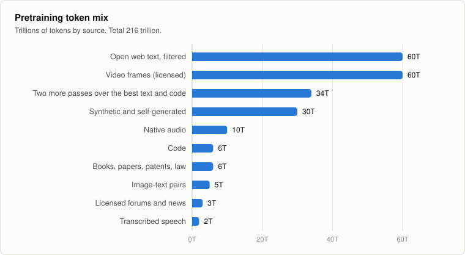
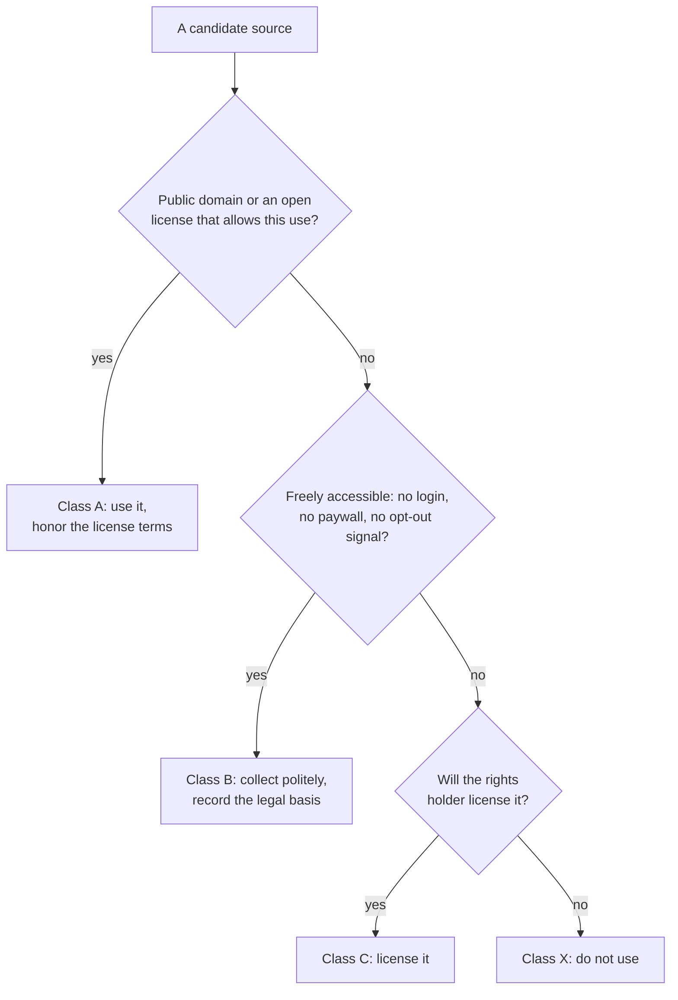

# 2. Data sources: where the training data is

[Back to the overview](../README.md) · Previous: [1. Scope and assumptions](01-scope-and-assumptions.md) · Next: [3. Data pipeline](03-data-pipeline.md)

A model of 10 trillion parameters wants about 216 trillion training tokens. This chapter says where that much data exists, how big each source really is, what may lawfully be used, and what it costs. Nothing was collected for this plan; the sizes below are published figures, researched on 21 November 2026 and listed in [chapter 19](19-sources.md).

## 2.1 The token budget

<picture>
  <source media="(prefers-color-scheme: dark)" srcset="../diagrams/token-mix-dark.svg">
  
</picture>

| Source | Tokens | Share | How it is obtained |
|---|---|---|---|
| Open web text, filtered and deduplicated, all languages | 60T | 28% | Own crawl plus Common Crawl archives |
| Video frames | 60T | 28% | Licensed libraries; open-licensed video |
| Two further passes over the best 17T of text and code | 34T | 16% | Repetition of the highest-quality material |
| Synthetic and self-generated | 30T | 14% | Earlier checkpoints, with automatic verification |
| Native audio | 10T | 5% | Licensed and open audio |
| Code | 6T | 3% | Public repositories with permissive licenses; licensed sources |
| Books, papers, patents, law, government records | 6T | 3% | Public domain, open access, publisher licenses |
| Image-text pairs | 5T | 2% | Licensed libraries; open sets |
| Licensed forums, social and news | 3T | 1% | Commercial agreements |
| Transcribed speech | 2T | 1% | Transcripts of the licensed audio and video |
| **Total** | **216T** | **100%** | |

Unique human-made material is about 152T tokens of that, of which about 77T is text. The rest is repetition (34T) and synthetic data (30T).

How ambitious is this? The largest training sets disclosed so far are 45T to 50T tokens (three models in 2026). This budget is four to five times larger. It is reachable only by going multimodal, by adding synthetic data, and by crawling at the scale of the largest disclosed effort. If the corpus comes in at half, the model is built at half the size ([chapter 4](04-model-and-parameters.md)).

## 2.2 How much data exists

### Text on the web

| Measure | Published figure |
|---|---|
| Common Crawl, latest monthly crawl (October 2026) | 2.16 billion pages; 371 TiB uncompressed; 86 TiB compressed |
| Common Crawl, whole archive since 2008 | 342 billion page captures; roughly 100 billion distinct URLs |
| Common Crawl archive in tokens (Epoch AI estimate) | About 130T (range 100T to 260T) |
| Indexed web in tokens (Epoch AI estimate) | About 510T (range 130T to 2,100T) |
| Whole web including deep and private content (Epoch AI) | About 3,100T |
| Google's index | "Hundreds of billions" of pages; about 400 billion documents in court testimony |
| Largest disclosed crawl for model training (Microsoft AI, 2026) | About 1.2 trillion pages crawled and parsed |

Raw size is misleading because most of it is duplication and low-quality text. What survives cleaning:

| Curated corpus | Size | Built from |
|---|---|---|
| FineWeb (English) | 18.5T tokens, 25.9 billion documents | 110 Common Crawl snapshots; 8.7% of page captures kept |
| RedPajama-V2 | 30.4T tokens after exact deduplication (20.5T English) | 84 Common Crawl snapshots |
| Essential-Web | 24T tokens, 23.6 billion documents | Common Crawl |
| FineWeb-2 (multilingual) | Over 3 trillion words in about 1,900 languages | 96 snapshots |
| FinePDFs | About 3T tokens from 475 million PDFs | Web PDFs |
| Common Corpus | 2.27T tokens, all public domain or openly licensed | Books, government, science, code |

Common Crawl alone yields about 20T to 30T usable tokens. Reaching 60T takes a crawl several times deeper. One published pipeline shows the funnel: 1.2 trillion pages crawled became 794 billion after policy filters, 423 billion after exact deduplication and 190 billion after near-duplicate removal. That lab then kept only the best few percent. This plan keeps about 40% of the deduplicated set across all languages, which is how it reaches 60T and why its average quality will be lower.

### Everything else

| Source | Published size | Tokens it could yield | License position |
|---|---|---|---|
| English Wikipedia | 7.27 million articles, 5.3 billion words | About 7B | CC BY-SA; attribution and share-alike apply |
| All Wikipedias | 68.8 million articles in 364 languages | About 35B | Same |
| Reddit | Over 2 billion posts and 22 billion comments | About 1T | Licensed commercially by Reddit; scraping is being litigated |
| Stack Exchange | 24 million questions, 36 million answers; 98 GB dump | About 0.03T | CC BY-SA. New questions are down more than 99% from the peak |
| GitHub | 630 million repositories, 395 million public (2025) | One lab reports 7.4T from public files, commits and pull requests | Per-repository licenses; permissive ones only |
| Software Heritage | Over 28 billion unique source files from 421 million projects | The Stack v2 extracts about 0.9T | Per-file licenses; bulk use by agreement |
| arXiv | 3.26 million papers; about 9 TB | About 0.05T | Mostly a non-exclusive license to arXiv only |
| PubMed Central | 8.4 million open-access articles; 5.6 million allow commercial use | About 0.06T | Per-article Creative Commons licenses |
| Scholarly full text elsewhere | 16 million (Semantic Scholar), 46 million hosted (CORE) | About 0.3T | Mixed |
| Books: Internet Archive | 8.4 million digitized books | About 2T | Mostly in copyright |
| Books: HathiTrust | 19 million volumes, about 7 million public domain | About 1.7T public domain | Research access; restricted |
| Books: Harvard Institutional Books | 983,004 public-domain volumes, 242B tokens | 0.24T | Commercial training use by arrangement |
| Books: Google Books | Over 40 million scanned | About 10T | Not available to others |
| Patents | Over 12 million US grants; 120 million publications worldwide | About 1T | Public records |
| Case law | Over 10 million US opinions; 6.7 million cases in an open CC0 set | About 0.05T | Public domain in the US |
| Company filings | About 4,700 a day into SEC EDGAR | Perhaps 0.5T (this plan's guess; no total is published) | Public records |
| Podcasts | 3.8 million shows, 198 million episodes | Tens of trillions as audio | In copyright |
| YouTube | About 15 billion videos; over 20 million uploaded a day | Hundreds of trillions as video | Terms forbid scraping; open-licensed slice is about 2 million videos |
| All internet video (Epoch AI) | About 10 trillion seconds, 2.8 billion hours | About 1,350T | Mostly in copyright |
| Image-text pairs | 5.5 billion (Re-LAION-5B); 12.8 billion (DataComp pool) | 3T to 6T | Links only; images keep their own copyright |

Two readings of that table. Text outside the open web is small: every book, paper, patent and court opinion that can be lawfully reached adds up to single-digit trillions. And the only pools measured in hundreds of trillions are video and audio, which is why any model at this scale is multimodal by necessity.

## 2.3 What may be used

The plan sorts every source into one of six classes before a byte is fetched.

Commissioned data (class D) and synthetic data (class E) are made for the purpose and enter with their own records.

| Class | What | Examples | Main condition |
|---|---|---|---|
| A | Public domain and open licenses | Wikipedia, government works, public-domain books, open-access papers, permissively licensed code, open corpora | Follow the license (attribution, share-alike where it applies) |
| B | Publicly accessible web | Pages reachable without logging in, with no opt-out | Lawful access only; honor `robots.txt` and AI opt-out signals; regional law decides the rest |
| C | Licensed | Publishers, news archives, forums, stock media, video and audio libraries | A contract that names model training |
| D | Commissioned | Expert-written problems, conversations, ratings, environments | Paid, consented, owned |
| E | Synthetic | Model-generated and program-verified data | Check for memorized third-party content |
| X | Excluded | Pirated book and paper libraries; content behind logins or paywalls without a license; sites that opt out; private data; illegal content | Never ingested |

Class X is not caution for its own sake. The one proven large liability in this field came from pirated books: a $1.5 billion settlement covering about 482,000 works, roughly $3,000 each, approved in July 2026.

## 2.4 The law as it stands in November 2026

The legal ground is unsettled and moving. This table is a snapshot, not advice.

| Place | Position | Key developments |
|---|---|---|
| United States | No statute. Two district courts found training on lawfully acquired works to be fair use on their records; one held that keeping pirated copies was not | The only appeals ruling so far (Third Circuit, September 2026) rejected fair use for a non-generative legal-research tool and counted a market for training licenses as harm, while saying generative cases are different. The large consolidated case against OpenAI awaits summary judgment. The Justice Department filed in support of fair use in September 2026 |
| United States, access | Separate from copyright | Contract and anti-circumvention claims against scrapers are surviving early motions in several courts. Getting around a technical barrier is its own exposure |
| European Union | Text-and-data-mining exception covers lawfully accessible works unless rights are reserved in machine-readable form | AI Act duties since August 2025, enforceable since August 2026: a copyright policy that honors opt-outs and a public summary of training content. An Advocate General's opinion (November 2026) treats training as generally permitted under the exception and `robots.txt` as a valid reservation; not yet a judgment. German courts have held that memorized song lyrics inside a model are reproductions (under appeal) |
| United Kingdom | Data-mining exception only for non-commercial research | A 2025 ruling found model weights are not an infringing copy; appeal heard November 2026. The government dropped its proposed opt-out exception in March 2026; no bill |
| Japan | Broad exception for information analysis | Guidance excludes uses that unreasonably harm the owner and warns against pirate sources |
| Singapore | Computational-analysis exception | Requires lawful access; cannot be contracted away |
| Privacy (EU) | Personal data in training needs a legal basis, usually legitimate interest | Draft 2026 guidance on scraping says to avoid sites aimed at minors and sites that block scraping |

Three consistent threads run through every jurisdiction: lawful access matters more than anything else; opt-out signals are gaining legal weight; and pirated sources are indefensible everywhere.

### What the plan does about it

| Practice | Why |
|---|---|
| Licensed-first for anything valuable and concentrated | Books, news, forums and media have identifiable owners and a market |
| A provenance ledger for every document | To answer "did you train on this, and on what basis?" for any item ([chapter 3](03-data-pipeline.md)) |
| Honor opt-outs everywhere, not only where required | Signals are converging across jurisdictions; one global standard is simpler and safer |
| Regional processing rules | Data collected under one region's exception is tagged with it |
| Ability to rebuild without any one source class | An adverse ruling removes a class, not the model |
| Output-side filters for verbatim reproduction | Memorization is where European courts have found infringement |
| Public training-data summary | Required in the EU: large datasets named, crawlers described, top domains listed |

## 2.5 Collecting from the open web

The norms the crawler is built around ([chapter 3](03-data-pipeline.md) has the engineering):

| Norm | Detail |
|---|---|
| `robots.txt` | The standard (RFC 9309) says its rules "are not a form of access authorization", but EU practice codes now make following it a commitment. A server error on the file means assume everything is disallowed |
| Separate training control | Major operators publish a distinct crawler name or token for training so that sites can refuse training without leaving search |
| Blocking is now common | Cloudflare reports that AI training rose to 52% of all crawler requests by June 2026, that 17% of sites block training crawlers, and that new ad-supported sites on its network refuse training by default from September 2026 |
| Paying per page | Pay-per-crawl exists in closed beta with a floor price of $0.001 a page. A collective license covering 3,000 media brands launched in November 2026 |
| Compliance is watched | One vendor measured 8.6% of AI bot requests ignoring `robots.txt`; publishers are suing over it |
| Being a light load | Wikimedia reports that bots account for at least 65% of its most expensive traffic. The plan uses bulk dumps wherever a site offers them |

For scale: Common Crawl fetches about 1,800 pages a second during a crawl, and the Internet Archive about 800 million a day. This plan's crawler would need about 51,000 a second for nine months.

## 2.6 Buying data

### What deals have cost

| Deal or source | Published figure |
|---|---|
| Reddit, content licensing revenue | $140M in 2025; about $60M a year reported from each of two AI companies |
| News Corp and OpenAI | Over $250M across five years |
| News Corp and Meta | Up to $50M a year |
| New York Times and Amazon | $20M to $25M a year |
| Wiley | $49M of AI licensing revenue in its 2026 fiscal year |
| Informa (Taylor & Francis) | Over $75M in 2024 |
| Shutterstock | $203M of data licensing in 2025, falling sharply in 2026 |
| HarperCollins | $5,000 per nonfiction title |
| Typical offer to a publisher | $1M to $5M a year |
| Whole market for AI training datasets | About $3.9B in 2026 by one estimate; 91 public deals since 2023 |

| Unit | Published price |
|---|---|
| A book | $5,000 to license; about $3,000 per work in the settlement over pirated copies |
| A crawled page | From $0.001 |
| A scholarly full-text file | $0.01 |
| An image | $0.02 to $1.00 |
| A minute of video | $1 to $4 |

### What the plan budgets

| Line | Per year | What it buys |
|---|---|---|
| Publishers: books, journals, news archives | $0.5B | Several million books and the major news and scholarly archives |
| Forums and social platforms | $0.2B | Reddit-class agreements |
| Video, audio and image libraries | $0.6B | See the warning below |
| Pay-per-crawl and collective web licenses | $0.2B | A few hundred billion paid page fetches |
| **Total** | **$1.5B** | |

**The video line is the weakest number in this chapter.** At the published $1 to $4 a minute, 100 million hours would cost $6B to $24B, more than all the other data put together. The plan assumes platform-scale agreements at roughly a tenth of the low end, plus open-licensed video. If that price is not available, the choice is fewer hours sampled more densely, or a smaller video share and a proportionally smaller model.

## 2.7 Synthetic and commissioned data

| Stream | Volume | Notes |
|---|---|---|
| Synthetic pretraining data | 30T tokens | Problems with checkable answers, code with tests, worked reasoning, translations, simulated tool use. Generated by pilot models and verified by programs before use |
| Commissioned human data | Small in tokens, large in value | Expert-written tasks and gradings for post-training ([chapter 9](09-post-training-and-fine-tuning.md)); about $1B a year |

Synthetic data in pretraining is a bet, not settled practice: one major lab's 2026 report says it used none. The risks are a model learning its own mistakes and a narrowing of style. The mitigations are verification, a cap at 14% of the mix, and an ablation at pilot scale ([chapter 17](17-risks-and-open-questions.md)).

## 2.8 Duties that come with the data

| Duty | What it requires |
|---|---|
| Child-safety law | Known abuse material must never be possessed: hash-matching runs before ingestion. Anything found is reported and preserved as the law requires. A 2023 audit found over 3,000 suspected items in one widely used image set, which is why open datasets are screened like everything else |
| Privacy | Personal data is filtered and minimized before training; a legal basis is documented per source class; a deletion path exists for future builds |
| Transparency | Public summary of training content; crawler identity and behavior published |
| Attribution | Share-alike and attribution licenses are tracked through the ledger |
| Security of licensed data | Contracted corpora are access-controlled and never leave the data zone ([chapter 13](13-security.md)) |

## 2.9 What could shrink the corpus

| Risk | Effect on the 216T |
|---|---|
| Web text of acceptable quality tops out near what Common Crawl already offers | Minus 30T |
| Video cannot be licensed at an affordable price | Up to minus 60T |
| Synthetic data hurts at pilot scale and is dropped | Minus 30T |
| A court or regulator removes a source class | Minus the class |
| Opt-outs keep spreading | A slow shrink of class B; pay-per-crawl costs rise |

A corpus of about 100T tokens is the pessimistic case. It supports a model of about 5T parameters, which would still be the largest ever disclosed.
