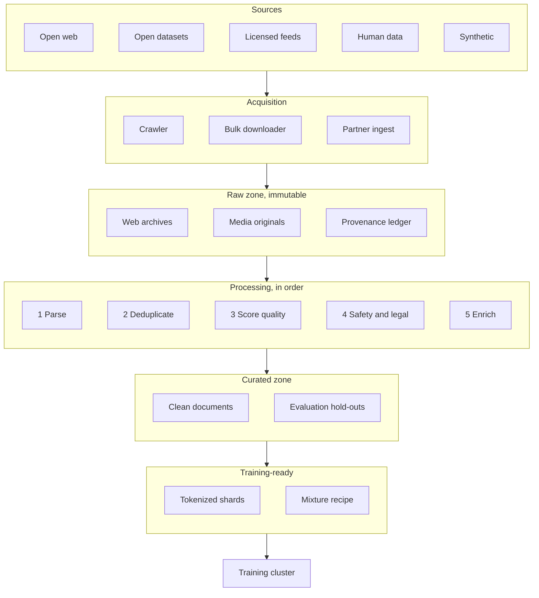
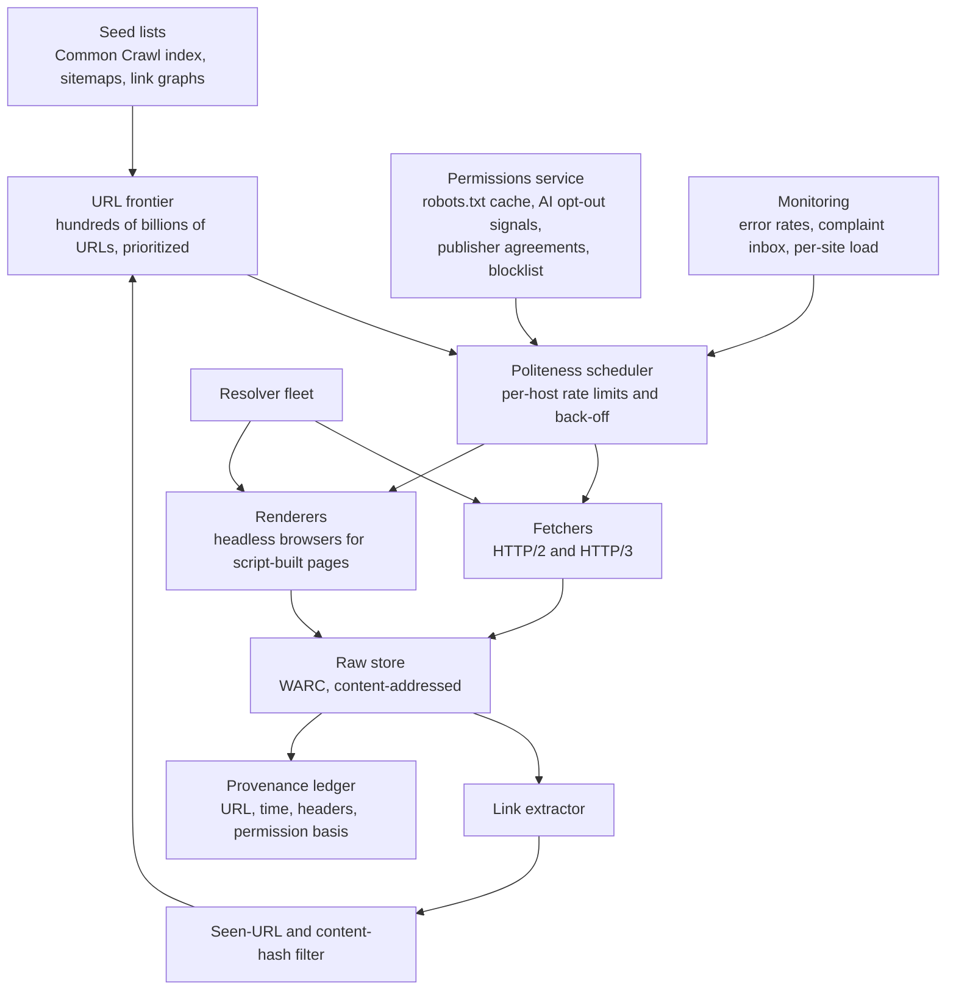
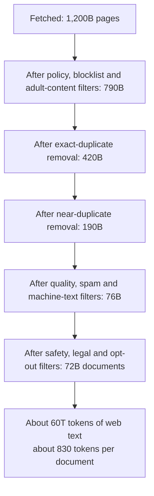

# 3. Data pipeline: from raw sources to training shards

[Back to the overview](../README.md) · Previous: [2. Data sources](02-data-sources.md) · Next: [4. Model and parameters](04-model-and-parameters.md)

The previous chapter says where the data is and what may lawfully be used. This chapter is the machinery that would turn it into 216 trillion clean, traceable training tokens. It is a design on paper: nothing here is run.

## 3.1 What the pipeline must deliver

| Requirement | Target | Why |
|---|---|---|
| Volume | 216T tokens across text, code, images, audio, video | Matches the compute-optimal token budget for a 10T-parameter model ([chapter 4](04-model-and-parameters.md)) |
| Raw intake | About 1.2 trillion web pages, 10 billion images, 100 million hours of video, 50 million hours of audio | About 16 pages are fetched for every document kept |
| Traceability | Every training token maps to a source, a license basis and a pipeline version | Legal defense, opt-out handling, EU training-data summary, debugging |
| Safety | Illegal content never reaches a training shard | Legal duty and model behavior |
| Reproducibility | Any shard can be rebuilt bit-for-bit from the raw zone | Science and audit |
| Time | Corpus v1 ready 12 months after start; refreshed quarterly | Data must be ready before the campus is |

## 3.2 End-to-end flow

## 3.3 The crawler

A web crawler at this scale is a distributed system in its own right. It would run in rented cloud regions and network points of presence near the content, not on the training campus.

### Size

| Quantity | Value | Basis |
|---|---|---|
| Pages fetched | 1.2 trillion over 9 months | The largest disclosed crawl for model training (Microsoft AI, 2026) parsed about this many |
| Fetch rate | About 51,000 pages per second (4.4 billion a day) | For comparison: Common Crawl about 1,800 a second, the Internet Archive about 9,000 |
| Bandwidth | About 180 Gbit/s sustained | 80% plain fetches at 60 KB, 20% rendered at 2 MB |
| Compressed archive | About 42 PB | 35 KB per page compressed; Common Crawl's own archives average about 40 KB |
| Fleet | 3,000 to 5,000 servers in 10 or more regions | Rendering JavaScript-heavy pages dominates the cost |

### Components

### Rules the crawler is built around

These are design constraints, not afterthoughts. A crawler that ignores them creates legal exposure that no amount of compute repays, and it damages the sites it depends on.

1. **Identify honestly.** One documented user agent, published IP ranges, a contact page. No rotating identities, no residential proxies.
2. **Obey `robots.txt`** (RFC 9309) and AI-specific signals: per-crawler rules, `noai`-style meta tags, the TDM Reservation Protocol, and the IETF AI Preferences vocabulary as it lands. A site that says no is skipped and recorded.
3. **Never pass an access control.** No logins, no paywall circumvention, no CAPTCHA solving, no scraping behind terms that require an account. Content behind those gates is licensed or left alone.
4. **Be a light load.** Adaptive per-host rate limits, back-off on errors or slow responses, conditional requests on recrawl, night-time scheduling for small hosts.
5. **Pay where payment is the door.** Budget for pay-per-crawl and licensing marketplaces instead of routing around them.
6. **Honor removal.** A public opt-out and takedown form feeds the blocklist; removed sources are dropped from the next corpus build.
7. **Keep a record.** Every fetch stores the permission basis that applied at that moment.

## 3.4 Processing stages and expected yield

The first three steps use the ratios published for a real pipeline of this size. The quality step is this plan's own: that pipeline kept only the best few percent of what survived deduplication, and this plan keeps about 40% across all languages. That is how it reaches 60T tokens, and it is the softest number in the funnel. Real yields are measured on a pilot crawl and the funnel is re-tuned.

| Stage | What happens | Typical loss |
|---|---|---|
| Parse, extract and policy filters | HTML to main content. Strip navigation, ads and boilerplate. Keep structure that carries meaning: headings, lists, tables, code blocks, mathematics. Detect language. PDFs and scans go through layout-aware OCR. Drop blocklisted and adult sites. | 34% |
| Exact deduplication | Content hash on normalized text. | 47% of what remains |
| Near-duplicate removal | MinHash or SimHash signatures with locality-sensitive hashing; paragraph-level removal of repeated templates, licenses, cookie notices. | 55% of what remains |
| Quality scoring | Cheap heuristics first (length, symbol ratio, repetition), then a small classifier trained on human-rated samples for coherence and information value, then perplexity under a small reference model to catch gibberish. Each document keeps its scores; thresholds are set per language and domain. | 60% of what remains |
| Spam and machine-generated text | Link farms, scraped copies, keyword stuffing, mass-produced AI text. In 2026 this is a large and growing share of new pages, and training on it degrades a model. | included above |
| Safety filters | See 3.5. | 5% combined |
| Legal filters | Opt-outs, takedowns, license class (code: permissive licenses only), jurisdiction rules. | |
| Enrichment | Source, date, license, language, topic, quality and toxicity scores attached as metadata. Images are re-captioned by a vision model; speech is transcribed; video is sampled into frames. | none |

Toxic or offensive text is **tagged, not blindly deleted**. A model that has never seen abuse cannot recognize or moderate it. The mixture recipe down-weights it; the truly illegal categories in 3.5 are removed outright.

### Compute for processing

Processing is cheap next to training. It runs on rented previous-generation GPUs and CPU fleets long before the campus exists.

| Job | Volume | Rough cost |
|---|---|---|
| Parsing and extraction | 1.2 trillion pages at about 20 ms of one CPU core each | About 7 million core-hours |
| Quality classifier | 190B documents through a model of a few hundred million parameters | About 1e23 FLOPs: hours on a modest GPU pool |
| Speech transcription | About 150M hours at roughly 150 times real time per GPU | About 1 million GPU-hours |
| Image re-captioning | 10B images at about 10 images per second per GPU | About 280,000 GPU-hours |
| Video frame tokenization | 3.6e11 frames at about 3,000 frames per second per GPU | About 33,000 GPU-hours |
| **Total** | | **Under 2 million GPU-hours, single-digit millions of dollars** |

## 3.5 Safety and legal filtering in the pipeline

This is the first layer of the guardrail stack described in [chapter 10](10-safety-guardrails-and-refusals.md). What the model never sees, it cannot reproduce.

| Category | Method | Action |
|---|---|---|
| Child sexual abuse material | Hash matching against industry databases for images and video, plus classifiers for unknown material and for related text | Remove, quarantine under legal hold, report to the designated authority (in the US, NCMEC). Never retained in any training zone. |
| Non-consensual intimate imagery | Hash matching and classifiers | Remove |
| Personal data | Detectors for emails, phone numbers, government identifiers, addresses, financial and health details | Redact or pseudonymize; drop documents that are mainly about private individuals |
| Secrets in code | Pattern and entropy scanners for keys, tokens, passwords | Redact |
| Malware | Antivirus and static analysis on code and binaries | Remove live malware; keep analyses and write-ups |
| Mass-casualty weapon specifics | Classifier trained with domain experts on a written policy | Remove the narrow slice that is real operational uplift; keep the science education |
| Opted-out and taken-down sources | Blocklist join | Remove |
| Poisoned or adversarial documents | Source reputation tiers, anomaly detection on token statistics, canary checks for known trigger patterns | Quarantine and review |

Data poisoning deserves its own line. Published work shows that a few hundred crafted documents can plant a backdoor regardless of model size, so "it is a tiny share of the corpus" is no defense. The mitigations are source-level trust tiers, caps on how much any one domain can contribute, and behavioral backdoor scans on trained checkpoints.

## 3.6 Storage layout

| Zone | Contents | Format | Size (planning) |
|---|---|---|---|
| Raw | Crawl archives, media originals, partner deliveries | WARC, original media files; immutable; erasure-coded object storage | About 146 PB (42 crawl, 2 images, 100 video, 1.5 audio) |
| Curated | Clean documents with metadata, transcripts, captions | Columnar files, partitioned by source and language | Tens of PB |
| Features | Pre-tokenized video and audio latents, embeddings for deduplication | Binary shards | Tens of PB |
| Tokenized | The training set itself | Fixed-size binary shards with an index | Under 1 PB (216T tokens at 4 bytes) |
| Ledger | Provenance, permissions, pipeline versions | Database | Small, and the most important |
| **Provisioned** | Everything above with derived copies and replication | | **About 410 PB** |

The tokenized training set is tiny. A corpus that took more than a trillion page fetches to build fits in less than a petabyte once it is tokens. The bulk is raw video.

## 3.7 Tokenizer

| Choice | Value | Reason |
|---|---|---|
| Algorithm | Byte-pair encoding with byte-level fallback | No out-of-vocabulary failures in any language or file type |
| Vocabulary | 262,144 entries (2^18) | Large enough for good multilingual and code compression; the embedding table is under 0.1% of parameters |
| Training sample | About 100B tokens, balanced across languages, code and markup | Avoids an English-only bias in compression |
| Special tokens | Roles (system, user, assistant, tool), tool-call delimiters, reasoning delimiters, modality markers | These are what the instruction hierarchy in chapter 10 is built on |
| Images, audio, video | Encoders map patches and frames to continuous embeddings in the same sequence; a discrete codec is kept for audio output | One model, one context window |

## 3.8 From curated data to a training mixture

1. **Mixture recipe.** A versioned file states the share of every source ([chapter 2](02-data-sources.md) has the table). It is the single most consequential hyperparameter after model size.
2. **Ordering.** Shards are shuffled with a fixed seed so any run can be replayed exactly. The best 17T tokens of text and code are scheduled to appear three times.
3. **Curriculum.** Short contexts dominate early; long documents, multi-file code and long video arrive later, when the model can use them.
4. **Hold-outs.** Evaluation sets are split off before tokenization and stored separately. Canary strings are planted so that leakage into training is detectable later.
5. **Refresh.** The crawl and the licensed feeds keep running. Each quarter produces a new corpus version for continued training and for the next model.

## 3.9 Governance

| Control | What it means in practice |
|---|---|
| Provenance ledger | For any output-side complaint, the team can answer: did we train on this, under what basis, in which version? |
| Opt-out and deletion | Requests remove the source from all future builds. A trained model cannot un-learn one document; the remedy is the next training run plus output-side filters. This limit is stated publicly. |
| Access control | Raw personal data and licensed corpora are readable by a small, logged group. Training jobs read only tokenized shards. |
| Privacy review | A data-protection impact assessment per source class; a named data-protection officer; regional rules applied by origin. |
| Transparency | A public training-data summary that satisfies the EU template and is useful beyond it. |
| Audit | Quarterly internal audit of permissions against the ledger; external audit before launch. |

## 3.10 People

About 250 staff in the data organization ([chapter 14](14-people-and-organization.md)): crawl and ingest infrastructure, pipeline engineering, quality research, licensing and partnerships, annotation operations, privacy and trust. Tens of thousands of contracted annotators and domain experts work through vendors on the human-data stream.
