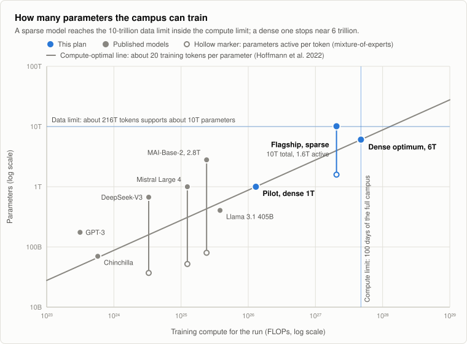
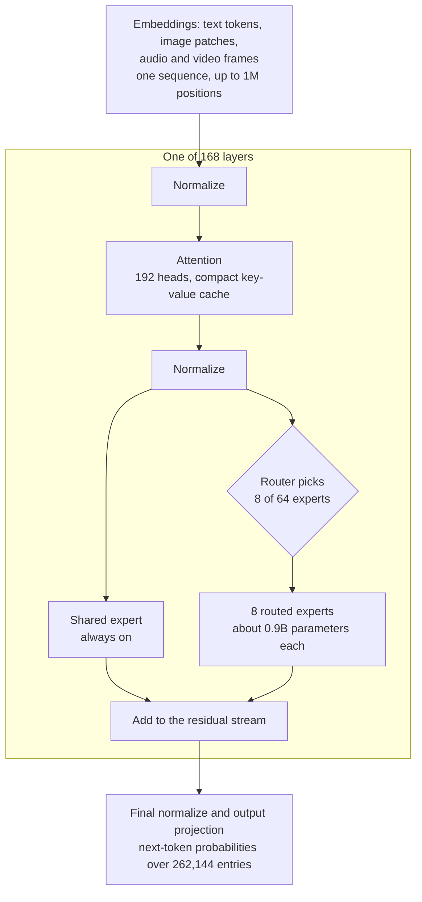

# 4. Model and parameters: how big can it be?

[Back to the overview](../README.md) · Previous: [3. Data pipeline](03-data-pipeline.md) · Next: [5. Compute cluster](05-compute-cluster.md)

## 4.1 The answer

**About 10 trillion parameters, as a sparse model. About 6 trillion if every parameter is used on every token.**

For scale: the largest parameter count officially disclosed for a released model is 2.8 trillion (Moonshot's open-weight Kimi K3 family, July 2026, with 104 billion active per token; Microsoft's unreleased MAI-Base-2 is the same size). Larger closed models are rumored and unconfirmed. Ten trillion is about three and a half times the largest confirmed.

Four limits decide the number:

| Limit | What it says | Where it lands |
|---|---|---|
| Data | The most quality data that can realistically be assembled is about 216T tokens ([chapter 2](02-data-sources.md)). At about 20 tokens per parameter that supports about 10T parameters | 10T |
| Memory | 10T parameters at 16-bit precision is 20 TB, the GPU memory of one rack. Beyond that every copy of the model spills across racks | 10T |
| Compute | 100 days of the full campus is about 4.8e27 FLOPs. That trains a sparse 10T model with room to spare, or a dense model of about 6T | Sparse 10T, dense 6T |
| Serving cost | A dense 6T model costs about four times as much per token to run as a sparse 10T model with 1.6T active | Sparse |

The recommended flagship is a **sparse mixture-of-experts transformer with about 10.1T total parameters, of which about 1.6T are active for any one token.**

<picture>
  <source media="(prefers-color-scheme: dark)" srcset="../diagrams/parameters-vs-compute-dark.svg">
  
</picture>

The same data as a table:

| Model | Total parameters | Active per token | Training tokens | Training compute (FLOPs) |
|---|---|---|---|---|
| GPT-3 (2020) | 175B | 175B | 0.3T | 3.1e23 |
| Chinchilla (2022) | 70B | 70B | 1.4T | 5.8e23 |
| DeepSeek-V3 (2024) | 671B | 37B | 14.8T | 3.3e24 |
| Mistral Large 4 (2026) | 1.0T | 52B | Not stated | 1.2e25 |
| MAI-Base-2 (2026, unreleased) | 2.8T | 80B | 50T | 2.4e25 |
| Llama 3.1 405B (2024) | 405B | 405B | 15.6T | 3.8e25 |
| **This plan: pilot** | 1T | 1T | 21.6T | 1.3e26 |
| **This plan: flagship** | 10.1T | 1.6T | 216T | 2.1e27 |
| **This plan: dense alternative** | 6.1T | 6.1T | 131T | 4.8e27 |

Compute for sparse models is 6 times active parameters times tokens. Published figures are from the papers and from Epoch AI's database; sources are in [chapter 19](19-sources.md).

## 4.2 Limit one: compute

The standard estimate for training a transformer is

```
training FLOPs  =  6  x  parameters used per token  x  training tokens
```

The campus delivers ([chapter 5](05-compute-cluster.md) explains each line):

| Step | Value |
|---|---|
| GPUs | 259,200 |
| Vendor peak per GPU: 4-bit / 8-bit / 16-bit | 35 / 17.5 / 4 PF |
| Planning rate per GPU while training | 2.5 PF |
| Campus while a job is running | 6.5e20 FLOP/s (648 exaFLOPS) |
| Times 0.85 uptime | 5.5e20 FLOP/s |
| Per day | 4.8e25 FLOPs |
| Per 100 days | **4.8e27 FLOPs** |
| Per year | 1.7e28 FLOPs |

The planning rate is 7% of the 4-bit headline. That gap is the difference between a kernel benchmark and a real training job, and it is the single most important number in the plan.

For context, the largest training run estimated to date is about 9.4e26 FLOPs (Epoch AI's estimate for a model released in September 2026), and no run is yet estimated above 1e27. The flagship's pretraining at 2.1e27 would be about twice that.

### What the scaling law says

The Chinchilla study found that for a fixed compute budget, loss is lowest when tokens and parameters grow together at about 20 tokens per parameter. Its published projection table includes:

| Parameters | Tokens | FLOPs |
|---|---|---|
| 1 trillion | 21.2 trillion | 1.27e26 |
| 10 trillion | 216.2 trillion | 1.30e28 |

A dense 10T model at that ratio needs 1.3e28 FLOPs, which is 273 days of the whole campus. That is not a sensible run. The compute-optimal dense model for a 100-day run is about **6.1T parameters on 131T tokens**.

A sparse model changes the arithmetic because compute follows active parameters. With 1.6T active, the same 216T tokens cost 2.1e27 FLOPs: 43 days of the full campus, or 72 days on the 60% of it assigned to the run.

### How sensitive is that?

| Case | Sustained per GPU | Uptime | FLOPs in 100 days | Largest compute-optimal dense model | Days for the sparse flagship on the full campus |
|---|---|---|---|---|---|
| Conservative | 1.2 PF | 80% | 2.2e27 | 4.1T on 88T tokens | 96 |
| **Planning** | 2.5 PF | 85% | 4.8e27 | **6.1T on 131T tokens** | **43** |
| Aggressive | 4.0 PF | 90% | 8.1e27 | 7.9T on 170T tokens | 26 |

The square root in the scaling law makes the dense answer forgiving: a fourfold spread in assumed throughput moves it by less than twofold. The sparse flagship is feasible in every case; only its duration changes.

## 4.3 Limit two: data

Parameters without tokens to train them are wasted. Published models cluster near 20 tokens per total parameter whether dense or sparse:

| Model | Tokens | Tokens per total parameter |
|---|---|---|
| Kimi K2 | 15.5T | 15.5 |
| MAI-Base-2 | 50T | 18 |
| DeepSeek-V4-Pro | Over 32T | 20 |
| DeepSeek-V3 | 14.8T | 22 |
| Llama 3.1 405B (dense) | 15.6T | 38.5 |
| **This plan** | 216T | 21 |

The largest disclosed training set is 50T tokens. This plan needs about four times that.

| Token budget | Supports about |
|---|---|
| 15T (largest disclosed text corpora, 2024) | 0.7T parameters |
| 50T (largest disclosed, 2026) | 2.5T |
| 100T (all quality text plus code plus synthetic) | 5T |
| **216T (text, code, synthetic, images, audio, video, with the best text seen three times)** | **10T** |

Getting to 216T requires going multimodal and synthetic, and passing over the best text three times. Published work finds that up to about four passes over the same data is nearly as good as fresh data, and that returns fall away after that. There is no obvious route to several hundred trillion useful tokens, which is why the plan does not chase a larger model.

## 4.4 Limit three: memory

| Form of the model | Size | What it fits in |
|---|---|---|
| Weights, 16-bit (training) | 20 TB | One rack's GPU memory (20.7 TB) with nothing to spare |
| Weights plus gradients plus working space | About 60 to 80 TB | A pod of four racks (82.9 TB) |
| Full checkpoint with optimizer state | About 100 TB | Parallel file system |
| Weights, 4-bit (serving) | 5 TB | One rack, with 15.7 TB left for conversation caches |

Ten trillion is where one served copy still fits comfortably in one rack, which keeps serving simple.

## 4.5 How sparse?

All four options use the same hardware and, except the dense one, the same 10.1T weights and 216T tokens.

| | A. Flagship (recommended) | Sparser | Denser | Dense alternative |
|---|---|---|---|---|
| Total parameters | 10.1T | 10.1T | 10.1T | 6.1T |
| Active per token | 1.6T (8 of 64 experts) | 0.67T (2 of 64) | 2.8T (16 of 64) | 6.1T |
| Training tokens | 216T | 216T | 216T | 131T |
| Pretraining compute | 2.1e27 FLOPs | 8.7e26 | 3.6e27 | 4.8e27 |
| Days on the full campus | 43 | 18 | 76 | 100 |
| Rack serving throughput (planning) | 119,000 tok/s | 280,000 | 67,000 | 31,000 |
| Hardware cost per million output tokens | About $1.50 | About $0.60 | About $2.60 | About $5.70 |

Why A:

1. **Every very large model with a disclosed architecture is sparse, and sparser than this.** The largest models of 2026 activate 3 to 4% of their parameters per token (104B of 2.8T, 95B of 2.4T, 49B of 1.6T, 80B of 2.8T) and train on 400 to 2,800 tokens per active parameter. They were built under tight compute. This plan is limited by data instead, so it activates more, about 16%, and buys quality with compute it has.
2. **Cheaper tokens buy capability at inference.** Reasoning quality rises with the number of thinking tokens spent. A model that is four times cheaper per token can think four times longer for the same money.
3. **The compute saved is spent better elsewhere.** Reinforcement-learning post-training and experiments have higher returns per FLOP at the margin than a denser base model ([chapter 9](09-post-training-and-fine-tuning.md)).
4. **Schedule risk.** Forty-three campus-days of exposure instead of a hundred.
5. **The dense alternative is smaller and sees less data.** It trades 40% of the capacity and 40% of the tokens for using every weight every time. No public evidence says that trade wins.

The sparsity level is a dial, not a commitment. The pilots at 100B and 1T parameters compare settings at matched compute, and the choice is made at month 16 ([chapter 17](17-risks-and-open-questions.md)).

## 4.6 Architecture

An illustrative configuration. Real values are set by the scaling ladder ([chapter 8](08-training-stack-and-run.md)).

| Setting | Value |
|---|---|
| Type | Decoder-only transformer, pre-normalization, rotary position encoding |
| Layers | 168 |
| Width (residual stream) | 24,576 |
| Attention | 192 heads of 128 dimensions; grouped-query with 8 key-value heads, so each layer caches only 2,048 values per token |
| Feed-forward | Mixture of experts: 64 routed experts plus 1 shared expert per layer; each a gated (SwiGLU) block of hidden width 12,288 |
| Routing | Top-8 of 64 per token, load-balanced |
| Vocabulary | 262,144, shared input and output embedding |
| Context window | 1,000,000 tokens |
| Modalities in | Text, code, images, audio, video in one token sequence |
| Modalities out | Text and code; speech through a small codec decoder |



### Parameter accounting

| Component | Per layer | All 168 layers | Share of total |
|---|---|---|---|
| Attention | 1.26B | 211B | 2.1% |
| Shared expert | 0.91B | 152B | 1.5% |
| Routed experts (64) | 58.0B | 9.74T | 96.3% |
| Embedding | | 6.4B | 0.1% |
| **Total** | **60.1B** | **10.11T** | **100%** |
| **Active per token** (attention, shared expert, 8 routed experts, output projection) | 9.41B | **1.59T** | 15.7% |

Almost all of the model is experts. Attention, which every token uses, is about 2% of the weights.

### Multimodal inputs

| Input | Tokens |
|---|---|
| Text | About 0.75 English words per token |
| Image | About 500 on average; 250 to 1,000 by resolution |
| Audio | About 50 per second |
| Video | About 170 per sampled frame, one frame per second in pretraining |

## 4.7 The model family

The flagship is the teacher. Two smaller models are distilled from it for volume ([chapter 9](09-post-training-and-fine-tuning.md)).

| Tier | Total | Active | Use |
|---|---|---|---|
| Flagship | 10.1T | 1.6T | Hardest problems, long autonomous work |
| Mid | About 1T | 200B | Default for most work |
| Small | About 100B | 30B | High volume, low latency, sub-agents, safety classifiers |

## 4.8 Where a year of the campus goes

The flagship's pretraining run is about 12% of the first campus-year. That matches how frontier labs spend compute. Epoch AI estimates that of roughly $5 billion OpenAI spent on research compute in 2024, the largest final training run was about $400 million: final runs were about a tenth, and experiments took most of the rest.

| Use | FLOPs | Share of one campus-year |
|---|---|---|
| Research experiments, ablations, scaling sweeps | 4.3e27 | 25.0% |
| Pilot and dress-rehearsal runs | 5.2e26 | 3.0% |
| **Flagship pretraining** | **2.1e27** | **11.8%** |
| Post-training, all variants and reruns | 2.5e27 | 14.7% |
| Evaluations, red teaming, classifier training, synthetic data | 7.0e26 | 4.0% |
| Reserve for restarts and reruns | 8.7e26 | 5.0% |
| Inference: internal use, previews, launch | 6.3e27 | 36.5% |
| **Total** | **1.7e28** | **100%** |

## 4.9 Caveats

- **The scaling law is an extrapolation.** It was fitted on dense models up to about 16B parameters, and the paper's own three methods give 21 to 94 tokens per parameter at the 1T scale. A 2024 re-analysis supports about 20. Using it at 10T is a forecast, which is why the plan has a ladder of pilots and a decision point before the flagship.
- **Sparse-model scaling is less well measured.** Published studies stop at a few billion parameters. The 20-tokens-per-total-parameter rule is used here because real sparse models cluster around it, not because theory says so.
- **Parameters are not capability.** Data quality, post-training and the harness each move results as much as a doubling of size.
- **The frontier will have moved.** Frontier training compute has grown about fivefold a year. If that continues, the largest runs of late 2028 will be around 2e28 FLOPs, which takes several campuses like this one or the next hardware generation. This plan describes one strong entry, not a permanent lead.
