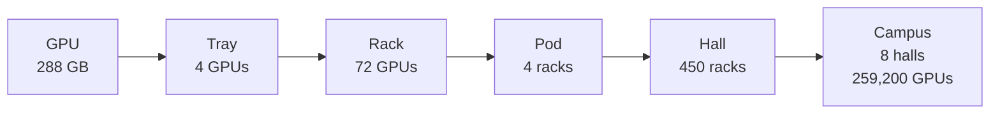

# 5. Compute cluster

[Back to the overview](../README.md) · Previous: [4. Model and parameters](04-model-and-parameters.md) · Next: [6. Networking and storage](06-networking-and-storage.md)

This chapter picks the accelerator, counts the racks, and answers the "how many teraflops" question twice: once with the vendor's headline number and once with a number a real training run could sustain. The gap between the two is the most important thing in the chapter.

## 5.1 The cluster on one page

| Item | Value |
|---|---|
| Rack | NVIDIA Vera Rubin NVL72, the fastest system shipping in volume in November 2026 |
| Racks | 3,600 (450 per hall) |
| GPUs | 259,200 (32,400 per hall) |
| GPU memory | 74.6 PB in total; 20.7 TB per rack |
| Power | 250 kW per rack position including its share of the network: 900 MW. Another 100 MW for storage, CPUs and management |
| Headline compute, 4-bit | 9.07e21 FLOP/s: 9.07 zettaFLOPS, or 9.07 billion teraFLOPS |
| **Sustained training compute (planning)** | **6.5e20 FLOP/s: 648 exaFLOPS, or 648 million teraFLOPS** |
| Training throughput on the flagship | About 41 million tokens per second on 60% of the campus |
| Hardware cost | About $30.6B for racks; $37.2B with network, storage and CPUs |

## 5.2 Choosing the accelerator

Options as of November 2026:

| System | Status | Per-rack figures (published) | Notes |
|---|---|---|---|
| **NVIDIA Vera Rubin NVL72** | Shipping in volume since September 2026; about $20B of revenue in its first quarter | 72 GPUs, 20.7 TB GPU memory, 2.5 EF dense 4-bit, 1.26 EF dense 8-bit | Chosen. Mature software stack, shipping now |
| NVIDIA GB300 NVL72 | Previous generation, widely deployed | 72 GPUs, 20 TB, about 135 kW, about $4M | Fallback for early halls if allocation slips |
| AMD Helios (MI455X) | First racks running at five large customers; volume in 2027 | 72 GPUs, 31 TB GPU memory, 2.9 EF 4-bit, 1.4 EF 8-bit | Second source to qualify; more memory per rack |
| Google TPU 8t | In Google's cloud; not sold as hardware | 12.6 PF 4-bit and 216 GB per chip; pods of 9,600 chips | Only available by renting |
| AWS Trainium3 | In AWS's cloud; not sold as hardware | About 2.5 PF 8-bit per chip, 144 per server | Only available by renting |
| NVIDIA Rubin Ultra (Kyber rack) | Announced for late 2027; a slip to 2028 has been reported and denied | 144 GPUs per rack | The upgrade path for halls 7 and 8 |

Nothing faster than the chosen rack ships before the second half of 2027.

## 5.3 Anatomy of one rack

| Part | Published specification |
|---|---|
| GPUs | 72 Rubin packages (two dies each) in 18 liquid-cooled trays of 4 |
| GPU memory | 288 GB of HBM4 per GPU; 20.7 TB per rack; about 1.4 PB/s of memory bandwidth per rack |
| CPUs | 36 Vera CPUs (88 cores each): 3,168 cores and up to 54 TB of system memory |
| Scale-up network | NVLink 6 switch trays joining all 72 GPUs at 3 to 3.6 TB/s each (published figures differ) |
| Scale-out network | Two 800 Gbit/s ports per GPU: 144 per rack |
| Data processing units | 18, each with two 400 Gbit/s ports, for storage and management traffic |
| Local flash | About 550 TB per rack |
| Power | Four 110 kW power shelves (three carry the full load), fed at 415 to 480 V AC, with a liquid-cooled 54 V busbar and about 400 J of energy storage per GPU |
| Cooling | Fanless compute trays; coolant inlet at 45 °C |
| Size and weight | 600 by 1,200 by 2,300 mm; about 1,800 kg; about 1.3 million components |
| Rack power | Analyst estimates of 180 to 227 kW depending on power profile. The vendor's reference design budgets about 2 MW for 8 racks with their network: 250 kW per position. The plan uses 250 kW |
| Price | Analyst estimates from $6M to $9.1M. The plan uses $8.5M |

## 5.4 Teraflops: the headline and the real number

The vendor publishes four dense figures per GPU. They differ by almost a factor of nine, depending on how many bits each number uses.

| Precision | Per GPU | Per rack | Campus | Campus in teraFLOPS |
|---|---|---|---|---|
| 4-bit (the headline) | 35 PF | 2.52 EF | 9.07e21 | 9.07 billion |
| 8-bit | 17.5 PF | 1.26 EF | 4.54e21 | 4.54 billion |
| 16-bit | 4 PF | 0.29 EF | 1.04e21 | 1.04 billion |
| **Planning rate for real training** | **2.5 PF** | **0.18 EF** | **6.48e20** | **648 million** |

The vendor also quotes 50 PF per GPU for 4-bit inference; that figure assumes sparsity and is not used here.

### Why 2.5 PF, and not 35

Peak figures describe one matrix multiply running flat out. A training job also moves data between GPUs, waits on the network, runs layers that need higher precision, and for a sparse model spends time routing tokens to experts. The honest way to pick a planning number is to start from what real runs achieved.

| Measured or estimated result | Sustained rate per GPU |
|---|---|
| Llama 3.1 405B on H100 GPUs at 16-bit: 38 to 43% utilization | 0.38 to 0.43 PF |
| DeepSeek-V3 on H800 GPUs with 8-bit matrix multiplies | 0.33 PF |
| MAI-Base-2 (sparse, 2.8T parameters) on GB200: 21% utilization | 0.46 PF |
| Mistral Large 4 on GB200: 36% utilization | 0.83 PF |
| Epoch AI's assumption for a frontier lab's run on GB200 | 1.2 PF |
| MLPerf Training, November 2026: this rack against the previous generation, per GPU | 1.4 to 2.0 times |

Chaining the best of those (1.2 PF on the generation before last, a modest step to the last generation, then the best measured twofold gain) gives about 2.5 PF. That is the planning rate. It equals 62% of the 16-bit peak, 14% of the 8-bit peak and 7% of the 4-bit headline. It assumes mature 8-bit training and a team that is good at this.

| Case | Per GPU | Why |
|---|---|---|
| Conservative | 1.2 PF | Sparse model at today's measured utilization; little benefit from low precision |
| **Planning** | **2.5 PF** | Best published results chained forward |
| Aggressive | 4.0 PF | Most arithmetic at 4-bit works at scale; utilization near the best reported |

One more published caution: the vendor's claim of up to four times the training performance per watt of the previous generation is not what the first benchmark results show. Measured gains per watt are closer to one to one-and-a-half times.

### The same thing per level

| Level | GPUs | Headline 4-bit, teraFLOPS | Sustained, teraFLOPS |
|---|---|---|---|
| GPU | 1 | 35,000 | 2,500 |
| Rack | 72 | 2.52 million | 180,000 |
| Hall | 32,400 | 1.13 billion | 81 million |
| Campus | 259,200 | 9.07 billion | 648 million |

Multiply sustained figures by 0.85 for uptime over a long run: 5.5e20 FLOP/s averaged over the calendar, 4.8e25 FLOPs a day, 1.7e28 a year.

## 5.5 Tokens per second in training

Training throughput is the sustained rate divided by 6 FLOPs per active parameter per token.

| Job | Hardware assigned | Tokens per second |
|---|---|---|
| Flagship (1.6T active) | 60% of the campus: 155,520 GPUs | About 41 million |
| Flagship | Whole campus | About 68 million |
| Dense 6T alternative | Whole campus | About 18 million |
| Pilot (dense 1T) | 25% of the campus | About 27 million |

## 5.6 The rest of the 1,000 MW

| Load | MW | What it is |
|---|---|---|
| GPU rack positions, including the scale-out network | 900 | 3,600 positions at 250 kW |
| Storage | 25 | Flash file system and object store ([chapter 6](06-networking-and-storage.md)) |
| CPU fleet | 20 | About 20,000 servers: data processing, evaluation, and the sandboxes for agentic reinforcement learning (about 52,000 running at once) |
| Front-end network, management, security systems | 10 | |
| Headroom | 45 | Growth, spares on warm standby, next-generation pilots |

## 5.7 How this compares with what exists

Published and estimated figures for the largest sites, late 2026:

| Site | IT power | Accelerators |
|---|---|---|
| Project Rainier, New Carlisle (Amazon, for Anthropic) | About 1,040 MW | More than 500,000 Trainium2 chips |
| Colossus 2, Memphis | About 950 MW | About 220,000 Blackwell-generation GPUs, more arriving |
| Stargate Abilene (Oracle and OpenAI) | About 820 MW | About 400,000 Blackwell-generation GPUs |
| Microsoft Fairwater, Atlanta | About 640 MW | GB200 |
| Meta Prometheus, Ohio | About 470 MW | Blackwell generation |
| **This plan** | **1,000 MW** | **259,200 Rubin GPUs** |

Only one site exceeds 1 GW of IT load today, and it runs custom chips. No NVIDIA-based site is verified at 1 GW, and none of the sites above is built on the Rubin generation: the largest disclosed Rubin cluster is the vendor's own 1,024-GPU benchmark system. This plan would be the first of its kind, which is a risk as well as a distinction.

Fewer GPUs than Abilene at more power is not a mistake. Each Rubin GPU draws about 3.5 kW all-in against roughly 2 kW for the previous generation, and does about twice the work.

## 5.8 Buying 3,600 racks

| Issue | Plan |
|---|---|
| Supply | 3,600 racks is more than the vendor shipped in this product's first full quarter. Allocation is contracted in month 1, with deliveries spread over months 11 to 26 at about 240 racks a month |
| Integration | Racks arrive built and tested from the integrator; on site they are placed, connected to power, coolant and fiber, and burned in for two weeks |
| Spares | 2% of racks on warm standby; trays, power shelves and optics stocked on site |
| Second source | AMD's rack qualified in a pilot row during year 2 |
| Obsolescence | Halls 7 and 8 are built for higher-density successors. First-generation racks move to inference as they are displaced |

## 5.9 Cost

| Item | Cost |
|---|---|
| 3,600 GPU racks at $8.5M | $30.6B |
| Scale-out network, optics, cabling | $4.6B |
| Storage | $1.0B |
| CPU fleet | $1.0B |
| **IT hardware** | **$37.2B** |

The vendor's own figure for its content in a gigawatt of this generation is about $40B, so the estimate is in the published range.
