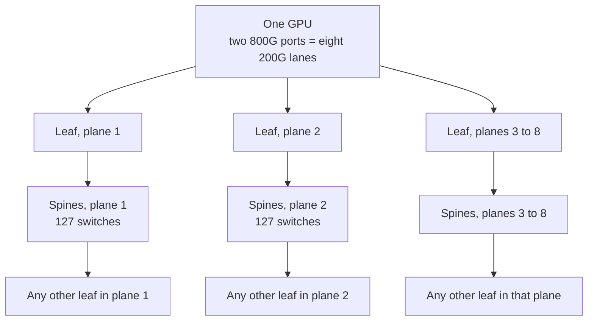

# 6. Networking and storage

[Back to the overview](../README.md) · Previous: [5. Compute cluster](05-compute-cluster.md) · Next: [7. Data center, power and cooling](07-data-center-power-and-cooling.md)

A quarter of a million GPUs are one computer only if they can talk to each other fast enough. This chapter designs the networks that join them, the links to the outside world, and the storage that feeds and protects the run.

## 6.1 Five networks

| Network | Joins | Speed | Carries |
|---|---|---|---|
| Scale-up | The 72 GPUs inside a rack | 3 to 3.6 TB/s per GPU over copper | Splitting single matrices and experts across GPUs |
| Scale-out (backend) | Every GPU on the campus | 1.6 Tbit/s per GPU | Gradients, activations between racks |
| Front-end and storage | Racks to storage and services | 2 x 400 Gbit/s per tray | Training data, checkpoints, logs |
| Management | Every device, out of band | 1 to 10 Gbit/s | Control, telemetry, recovery |
| Wide area | The campus to the world | 3.2 Tbit/s over two routes | Data ingest, replication, users |

## 6.2 The backend fabric

### Design

| Choice | Value | Reason |
|---|---|---|
| Technology | Ethernet with co-packaged optics | The largest real clusters (Abilene, Fairwater, Colossus) run Ethernet backends; co-packaged-optics switches have been in production since May 2026 |
| Ports per GPU | Two at 800 Gbit/s | The rack's standard configuration |
| Planes | 8, by splitting each 800G port into four 200G lanes | Many thin planes let a two-tier network reach far more GPUs than a few fat ones |
| Tiers | Two per plane: leaf and spine | Fewer hops, fewer optics and fewer failure points than three tiers |
| Switch | 512 x 800G chassis used as 2,048 x 200G ports | A two-tier plane of these reaches about 2.1 million GPUs, so 259,200 fits with room to grow |
| Oversubscription | None | Every GPU can talk to any other at full rate |

Published designs back the approach: the switch vendor quotes up to 128,000 GPUs in two tiers with its multi-plane design, and OpenAI describes reaching about 131,000 GPUs in two tiers by splitting each 800G port into eight 100G planes, where a conventional design would need three or four tiers.

### Counts

| Item | Count |
|---|---|
| GPU ports at 800G | 518,400 |
| Leaf switches per plane | 254 |
| Spine switches per plane | 127 |
| Switch chassis in total | 3,048 |
| 200G lanes from GPUs to leaves | 2.07 million |
| 200G lanes from leaves to spines | 2.08 million |
| Optical links, counted as 800G equivalents | 1.04 million |
| Transceivers on the GPU side | 518,400 |
| Capacity at the edge | 415 Pbit/s |
| Capacity across any even split of the cluster | 207 Pbit/s |

### Why co-packaged optics

With optics built into the switch, a port draws about 5 W instead of about 25 W for a pluggable module. Across 1.56 million switch ports that is about 8 MW instead of 39 MW, and about a million and a half fewer field-replaceable parts to fail. Without it the fabric would also need about 2 million pluggable transceivers.

### What the fabric has to survive

| Event | Response |
|---|---|
| A lane or link fails | Traffic shifts to the other planes within milliseconds; the GPU keeps seven-eighths of its bandwidth |
| A leaf switch fails | Its GPUs lose one plane of eight; the job continues |
| A spine fails | Under 1% of one plane's capacity is lost |
| Congestion from synchronized gradient exchange | Per-packet load balancing across planes; congestion control tuned for the job's traffic pattern |
| A whole plane misbehaves | It is drained and repaired while the other seven carry the job |

### Why bandwidth per GPU matters as much as compute

Each training step, every pod exchanges about 20 TB of gradients ([chapter 8](08-training-stack-and-run.md)). A pod of 288 GPUs has 57.6 TB/s of fabric bandwidth, so that exchange takes about 0.7 seconds of a 6.6-second step. At half the bandwidth it would take 1.4 seconds and cost a tenth of the campus's output.

### Cabling

About 2 million fiber pairs leave the racks. They run as pre-terminated trunk cables in overhead trays to leaf rows placed mid-hall, and from there to two spine rooms per plane group. Two-story halls keep the longest run short. For comparison, Microsoft has said that one of its sites of about half this size contains enough fiber to circle the Earth more than four times.

## 6.3 Front-end and storage network

| Item | Value |
|---|---|
| Ports | 18 data processing units per rack, each with two 400G ports: 64,800 units campus-wide |
| Capacity per rack | 14.4 Tbit/s |
| Topology | Separate Ethernet fabric, two tiers per hall and a campus core |
| Isolation | The data processing units enforce tenant and zone boundaries in hardware, outside the reach of software on the host ([chapter 13](13-security.md)) |

Keeping storage traffic off the backend fabric means a checkpoint never competes with a gradient exchange.

## 6.4 Wide-area links

Tokens are tiny. The whole flagship serving fleet writing about 30 million tokens a second produces roughly 1 Gbit/s of text. Bandwidth to the outside world is driven by moving data in, not answers out.

| Flow | Rate | Notes |
|---|---|---|
| Web crawl | About 180 Gbit/s sustained | Runs in rented regions near the content, not on campus ([chapter 3](03-data-pipeline.md)) |
| Media ingest | About 35 Gbit/s averaged over nine months | About 100 PB of licensed video and audio; the largest deliveries arrive on shipped drives |
| Curated corpus to campus | 10 to 50 Gbit/s | The tokenized set is under 1 PB |
| Checkpoint replication off site | About 45 Gbit/s in bursts | A 20 TB weights file in under an hour, encrypted |
| Serving traffic | A few Gbit/s | Dominated by images, audio and files that users upload |
| **Provisioned** | **Eight 400G wavelengths, four on each of two physically separate routes: 3.2 Tbit/s** | Either route alone carries everything |

## 6.5 Storage

| Tier | Technology | Size | Job |
|---|---|---|---|
| Local flash in the racks | Solid-state drives in every tray | About 550 TB per rack, about 2 EB campus-wide | Data cache for the next few minutes; local snapshots every 15 minutes |
| Parallel file system | All-flash | 60 PB usable; 2.5 TB/s write, 5 TB/s read | Durable checkpoints; hot datasets; evaluation outputs |
| Object store | High-capacity disk, erasure coded | About 410 PB for data, about 12 PB for checkpoint history | Raw crawl, media, curated corpus, archives |
| Off-site copy | Object storage in a second region | Irreplaceable sets only | Corpus ledger, licensed deliveries, sealed checkpoints |

### Checkpoint arithmetic

| Item | Value |
|---|---|
| Weights only (16-bit) | 20.2 TB |
| Full state with optimizer statistics | 101 TB |
| Time to write a full checkpoint to the flash tier | About 40 seconds at full rate; 5 minutes budgeted |
| Kept | 40 full checkpoints and 400 weights-only checkpoints: about 12 PB |

### Is that enough storage?

It is small next to some published systems and deliberately so. Meta built 240 PB of flash delivering 2 to 7 TB/s for a 16,000-GPU cluster, and the rack vendor's reference design asks for 90 to 280 GB/s of read throughput per 576 GPUs. Those numbers are driven by training directly on raw images and video. This plan pre-tokenizes media offline, so the training job reads about 160 MB/s of token ids and compact features. The flash tier is sized for checkpoints, not for data loading.

## 6.6 Cost and power

| Item | Capital cost | Power |
|---|---|---|
| Backend fabric: 3,048 switch chassis, optics, about 2 million fiber pairs | $4.6B (15% of rack cost) | Included in the 250 kW per rack position |
| Front-end and management networks | Included above | About 10 MW |
| Storage: flash tier and object store | $1.0B | About 25 MW |
