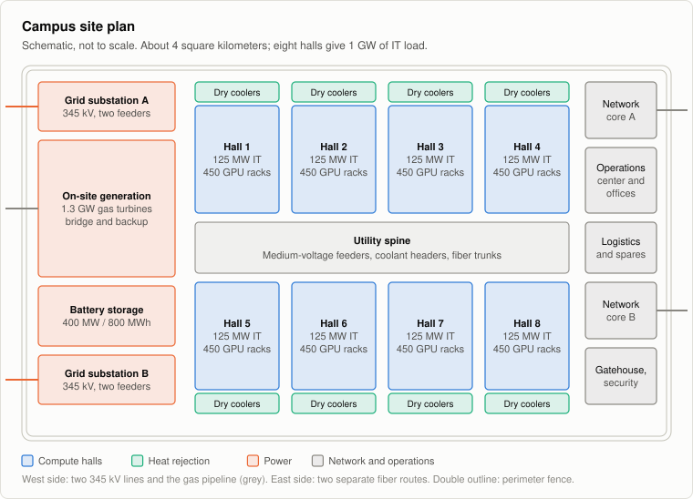
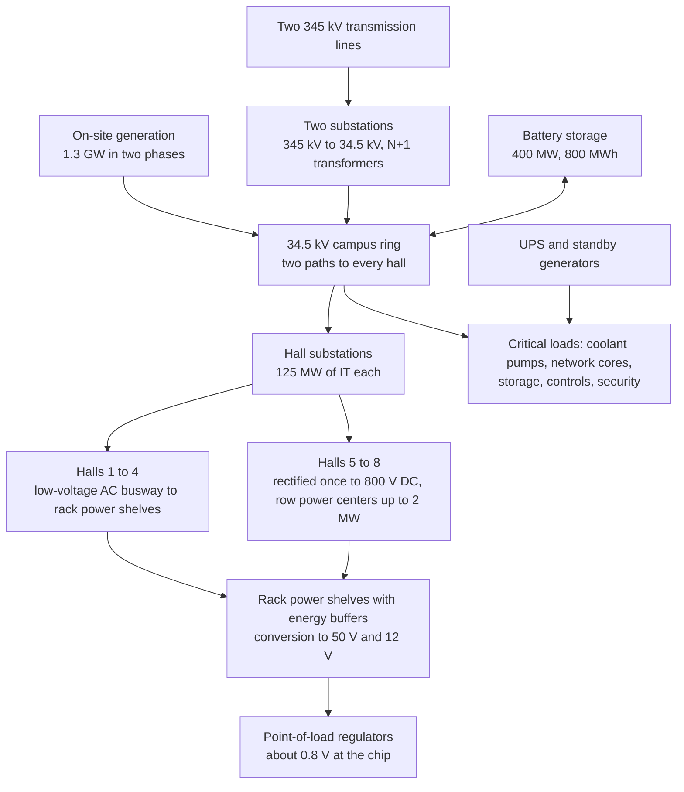
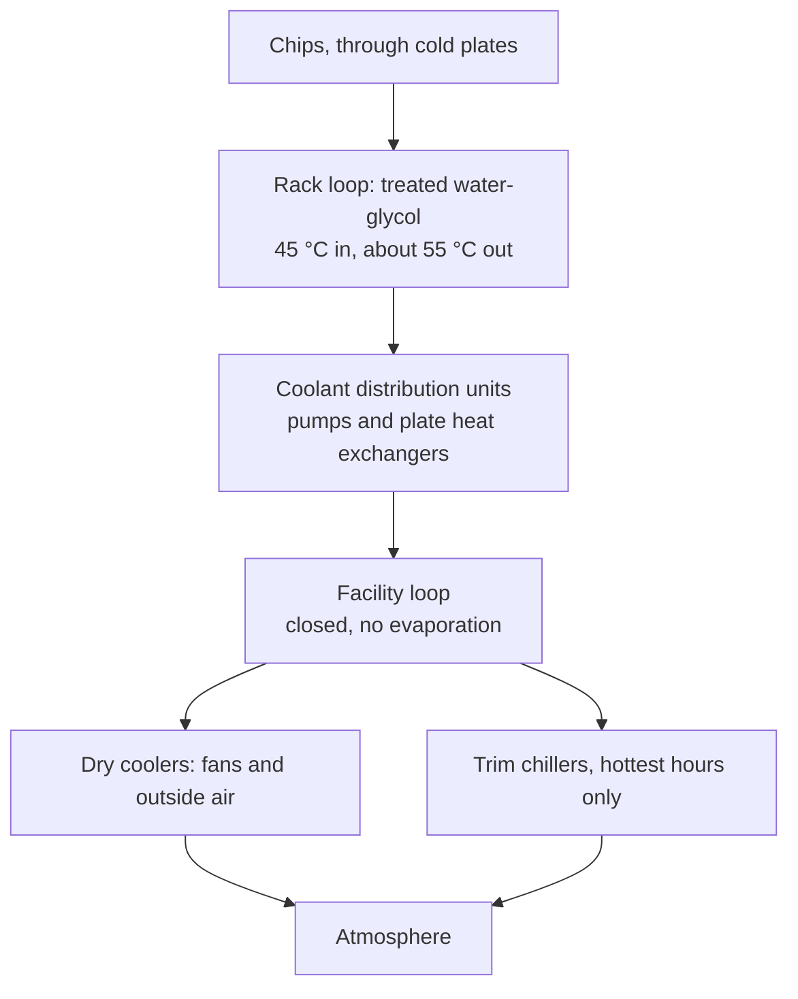

# 7. Data center, power and cooling

[Back to the overview](../README.md) · Previous: [6. Networking and storage](06-networking-and-storage.md) · Next: [8. Training stack and the pretraining run](08-training-stack-and-run.md)

The model is trained by electricity turned into arithmetic and then into warm water. This chapter sizes the campus that does it: the site, the power chain, the cooling plant, the buildings, and what it all costs. Figures marked "published" come from real campuses and 2026 industry sources listed in [chapter 19](19-sources.md); the rest are this plan's design.

## 7.1 The campus on one page

| Item | Value | Basis |
|---|---|---|
| IT load | 1,000 MW | Design target |
| Facility power, annual average | 1,150 MW | PUE 1.15; published modeling value for AI-specialized sites is 1.14 |
| Facility power, electrical nameplate | 1,300 MW | 1.3 times IT for the hottest day and all losses, the ratio seen at built campuses |
| Data halls | 8, at 125 MW of IT each | Abilene uses 8 buildings of about 103 MW IT |
| Floor area | About 4 million sq ft | About 485,000 sq ft per building at Abilene |
| Land | About 1,000 acres (4 km²) | Abilene: 800 to 1,000 acres |
| Energy | 10.1 TWh a year at full load; 8.6 TWh at an 85% load factor | `calc/sizing.py` |
| Electricity bill | $580M to $690M a year | $68/MWh, Texas industrial average in 2026 |
| Cooling | Closed-loop liquid at 45 °C supply, dry heat rejection | Matches the rack vendor's specification |
| Water | Near zero in operation | One-time loop fill |
| Heat rejected | About 1.15 GW, continuously | Everything that comes in as electricity leaves as heat |

## 7.2 Choosing the site

Training does not care about latency to users. The campus goes where the power is.

| Criterion | Requirement | Why |
|---|---|---|
| Firm power | 1.3 GW deliverable in stages within 24 months | The critical path of the whole program |
| Transmission | A 345 kV or 500 kV corridor with spare capacity nearby | New long-distance lines take longer than the campus |
| Gas | A high-pressure pipeline at or near the boundary | On-site generation is the bridge and the backup |
| Fiber | Two physically separate long-haul routes | Data ingest and operations; inference traffic is small |
| Climate | Cool and dry is better, but 45 °C coolant makes most climates workable | Sets how many hours trim chillers run |
| Land | 1,000 flat acres with room to double | Next-generation halls |
| Water | Little needed | Closed loop |
| Permitting and community | A jurisdiction that wants it, with a negotiated benefits agreement | Opposition and moratoria are now a leading cause of delay |
| Hazards | Low flood, seismic, wildfire and tornado exposure | Insurance and uptime |
| Workforce | Electricians and mechanical trades within reach | The scarcest construction input |

Published industrial electricity prices for January to August 2026, in dollars per MWh, show why builders cluster where they do: New Mexico 52, Louisiana 66, Texas 68, Tennessee 68, Georgia 87, Indiana 92, Virginia 101, Ohio 102, against a US average of 91. These are state-average tariffs, not negotiated contracts.

The real constraint is not price. Grid connection in primary US markets now takes more than four years on average, and Texas alone has about 474 GW of large loads waiting in its queue. That is why every campus built quickly has brought some or all of its own generation.

## 7.3 Site plan

<picture>
  <source media="(prefers-color-scheme: dark)" srcset="../diagrams/campus-site-plan-dark.svg">
  
</picture>

| Block | Contents |
|---|---|
| West: power | Two 345 kV substations on separate transmission lines, the on-site generating plant, the battery yard, the gas metering station |
| Center: compute | Eight halls in two rows. Each hall has its heat-rejection yard on the outer side and faces a shared utility spine carrying medium-voltage feeders, coolant headers and fiber trunks |
| East: network and operations | Two network cores in separate buildings on separate fiber routes, the operations center, logistics and burn-in, the single staffed entrance |

## 7.4 Power

### Sources

| Source | Capacity | Role | Online |
|---|---|---|---|
| Grid, two 345 kV feeds into two substations | 1,200 MW | Primary once energized | 300 MW by month 12, full by month 18 to 24 |
| On-site generation, phase 1: fuel cells, reciprocating engines, aeroderivative turbines | 400 MW | Bridge power for halls 1 and 2 | Month 12 |
| On-site generation, phase 2: larger gas turbines, combined cycle where slots allow | To 1,300 MW | Carries the campus if the grid is late; backup and grid support afterwards | Month 24 |
| Battery storage | 400 MW / 800 MWh | Smooths training-load swings; ride-through for faults; about 40 minutes of full-site carry | Month 10 to 20 |
| Long-term clean supply | Contracts sized to the full load | Nuclear, geothermal, solar with storage, arriving 2030 onward | Signed in year 1 |

Two full power paths is expensive and deliberate. It is the single most important schedule protection in the plan.

This is also the plan's most optimistic assumption. Published 2026 lead times: new heavy-duty gas turbines are being sold into 2030 and 2031 delivery slots, large power transformers take about 128 weeks, generator step-up transformers about 144 weeks, and a combined-cycle project about five years. The best case assumes orders are placed in month 1 through reserved slots, and that phase 1 uses equipment that ships fast: fuel cells (one supplier reports delivering a system in 55 days and has gigawatt-scale data-center contracts), reciprocating engines (24 to 36 months) and smaller aeroderivative units.

How real campuses did it:

| Campus | Published power arrangement |
|---|---|
| Stargate Abilene | 1.2 GW grid interconnection, about 360 MW of on-site simple-cycle gas as backup, batteries and solar planned |
| Colossus 2 | About 2 GW behind the meter from gas turbines, 720 grid-scale battery units (about 2.8 GWh) able to island for four hours, grid hookup approved later |
| Meta Hyperion | Utility-built: three combined-cycle plants (2,262 MW, about $4.0B) and seven more proposed (over 5.2 GW) |
| Meta Prometheus | Islanded gas plant of about 30 small units, not grid-connected |
| Microsoft Fairwater | Utility supply; no on-site generation or battery backup for the GPU fleet |

### The chain from transmission line to chip

### Where the 1,150 MW goes

| Load | MW (annual average) | Share |
|---|---|---|
| GPU rack positions, including the scale-out network | 900 | 78.3% |
| Storage, CPU fleet, front-end network, management, headroom | 100 | 8.7% |
| **IT subtotal** | **1,000** | **87.0%** |
| Cooling: pumps, dry-cooler fans, trim chillers | 80 | 7.0% |
| Electrical losses: transformers, rectifiers, batteries, distribution | 50 | 4.3% |
| Buildings, lighting, controls, offices, security | 20 | 1.7% |
| **Facility total** | **1,150** | **100%** |

### Redundancy

A training job can be paused and resumed from a checkpoint. A hospital cannot. The campus is built accordingly.

| Load | Share of facility power | Protection |
|---|---|---|
| GPU racks and their network | About 78% | Two utility paths and on-site generation. No conventional UPS or diesel fleet behind them: rack energy buffers and site batteries cover faults and transfers. Microsoft has published the same choice for its Fairwater design |
| Cooling plant: pumps, fans, controls | About 7% | UPS and standby generators, N+1. Chips must be cooled through any shutdown |
| Storage, CPU fleet, front-end network, security, building systems | About 10% | Full UPS and generator backing for the critical part, concurrently maintainable |

### 800 V DC

Racks above about 200 kW push 50-volt distribution past its limits: the copper becomes unmanageable. The industry is moving to 800 V DC, converting from AC once at the edge of the hall. NVIDIA's published claims for the architecture are up to 5% better end-to-end efficiency and up to 45% less copper. Its published timeline in August 2026: a hybrid 800 V DC power rack in the second half of 2026, row-level power centers of up to 2 MW in 2027, and facility-scale DC later, with more than 80 manufacturers building to the open specification. Independent commentary in 2026 notes that engineers cannot yet fully specify an 800 V DC hall, and the racks shipping today are still fed with 415 to 480 V AC, converted in the rack to a 54 V busbar.

The plan therefore builds halls 1 to 4 on proven AC distribution and halls 5 to 8 as 800 V DC, with every hall sized so that next-generation racks of several hundred kilowatts can replace the first generation without rebuilding.

### Training-load power swings

When hundreds of thousands of GPUs compute in lock-step and then all pause to exchange gradients, the campus's draw moves by tens to hundreds of megawatts, with energy at 0.2 to 3 Hz. Utilities limit exactly that: ramp rate, dynamic range and oscillation. A 2024 grid event in which about 1,500 MW of data-center load dropped off at once on a single transmission fault is the cautionary case.

| Layer | Mechanism | Published evidence |
|---|---|---|
| In the rack | Capacitor and battery energy storage in the power shelves | The previous rack generation stored 65 J per GPU and cut peak grid demand 30% on a measured training job; the current one stores about 400 J per GPU and advertises up to 25% lower peak current |
| In software | A floor under GPU power, filler workloads during pauses, limits on ramp rates at job start and stop | Under 5% performance cost for a filler workload; a hard 90% power floor costs about 10% more energy |
| On site | 400 MW of batteries on the medium-voltage ring | Recommended for large sites; used at Colossus 2 and Fairwater |
| With the utility | Agreed ramp limits, ride-through settings, advance notice of large job starts | Required by grid operators |

## 7.5 Energy and emissions

| Scenario | Energy per year | CO2 per year |
|---|---|---|
| Full load, new combined-cycle gas (about 340 kg/MWh) | 10.1 TWh | 3.4 Mt |
| Full load, aeroderivative simple-cycle gas (about 480 kg/MWh) | 10.1 TWh | 4.8 Mt |
| 85% load factor, combined cycle | 8.6 TWh | 2.9 Mt |
| With contracted clean firm power replacing gas | 8.6 to 10.1 TWh | Residual backup only |

10 TWh a year is the electricity use of about 930,000 average US homes. A plan that stops at gas is a plan with a three-to-five megatonne annual footprint. The design treats gas as the bridge: clean firm contracts are signed in year 1 for delivery from 2030, in the pattern of published deals (an 835 MW nuclear restart contract, 2.6 GW of nuclear purchase agreements, geothermal projects in the 100 MW class), and the on-site plant moves to backup duty as they arrive.

## 7.6 Cooling

| Quantity | Value | Basis |
|---|---|---|
| Heat captured by liquid | About 950 MW (95% of IT) | Compute trays are fully liquid-cooled; network, storage and power gear shed the rest to air |
| Coolant supply temperature | 45 °C | Published rack specification |
| Coolant flow | About 24 m³/s (1.4 million L/min) | 10 K temperature rise, 25% glycol |
| Flow per GPU rack position | About 360 L/min | About 1.4 L/min per kW. A published 2 MW unit moves 2,125 L/min, about 1.1 L/min per kW at a wider temperature rise |
| Coolant distribution units | About 455 at 2.3 MW each, N+1 per row group | One unit serves about 8 racks |
| Heat-rejection units | About 700 at 1.8 MW each | Abilene: 640 units for 1,125 MW |
| Annual-average cooling power | About 80 MW | Pumps and fans |
| Water consumed | Near zero | Closed loops. Evaporative cooling at this scale would use on the order of 15 to 20 billion liters a year |

Why warm water matters: at a 45 °C supply the loop can reject heat to outside air whenever the air is cooler than about 38 °C, which is nearly every hour of the year at most sites. No compressors run most of the time. That is where the low PUE comes from. Published fleet figures for comparison: Google 1.09, AWS 1.14, Microsoft 1.17; the industry average is about 1.5.

| Design point | Choice |
|---|---|
| Leak management | Leak detection at every rack and manifold, drip trays, automatic isolation valves, negative-pressure options on rack loops |
| Coolant quality | Continuous filtration and chemistry monitoring; fluid life of six years or more |
| Pump power | On UPS, N+1, because chips must be cooled through any electrical event |
| Residual air load | Fan walls or rear-door heat exchangers for network, storage and power rows |
| Hot days | Trim chillers sized for the gap between dry-cooler capacity and peak load |
| Heat reuse | About 950 MW of 50 to 55 °C water is available. Near a city it can supply district heating (a published Finnish project aims to cover about 40% of a region's district heat from data-center waste heat). At a remote site there is rarely a taker, and the heat goes to air |

## 7.7 Buildings

| Item | Value |
|---|---|
| Hall IT load | 125 MW |
| GPU racks per hall | 450, in rows of 8 (2 MW per row with its network) |
| Other racks per hall | About 150: fabric switches, storage, CPU, management |
| Hall floor area | About 500,000 sq ft over two stories, to shorten cable runs |
| Floor loading | Designed for racks of two tonnes and more (the current rack weighs about 1,800 kg) |
| Ceiling services | Overhead busway, coolant headers, fiber trays |
| Fire protection | Detection and suppression suited to liquid-cooled electronics and battery rooms |
| Construction quantities, whole campus | Order of 100 miles of piling, 60 million lb of structural steel, 260 miles of medium-voltage cable and 160 miles of process piping, scaled from published figures for a 450 MW campus |

## 7.8 Build speed

| Campus | Published time to first power | Published time to about 1 GW |
|---|---|---|
| Colossus 2 | About 8 months | About 12 months |
| Stargate Abilene | About 13 months | About 25 months |
| Project Rainier, New Carlisle | About 16 months | About 23 months |
| Microsoft Fairwater | About 33 months | About 43 months |
| **This plan** | **10 months after ground-breaking (month 14)** | **22 months after ground-breaking (month 26)** |

Published peak construction workforces range from about 3,000 (Fairwater) through nearly 5,000 (Abilene) to more than 7,500 (Hyperion). This plan uses 6,000 ([chapter 14](14-people-and-organization.md)).

## 7.9 Cost

| Item | Cost | Basis |
|---|---|---|
| Buildings, electrical, cooling | $17.5B | $17.5M per MW of IT. Published 2026 figures: $17.6M/MW average for modern builds; $16M to $19M/MW for this rack generation |
| On-site generation, 1.3 GW | $2.9B | $2,200 per kW. Published all-in combined-cycle cost: about $2,150/kW in 2025 |
| Battery storage, 800 MWh | $0.24B | $300 per kWh |
| Substations and interconnection | $0.4B | Two 345 kV stations |
| Land and site works | $0.15B | |
| **Facility and power total** | **$21.2B** | |

IT hardware is another $37B ([chapter 15](15-budget.md)). Published all-in estimates for a gigawatt of this hardware generation run from $47B to $60B. This plan lands near the top of that range at about $58B because it owns its power plant and carries a second power path.

## 7.10 Running it

| System | Purpose |
|---|---|
| Building and power management | One operations center sees every breaker, pump, valve and rack |
| Digital twin | Thermal and electrical model of each hall used for commissioning and for planning rack upgrades |
| Integrated testing | Every hall is load-banked and failure-tested before racks arrive |
| Maintenance | Rolling, one row group at a time, coordinated with the training scheduler |
| Staffing | About 600 on site across four crews ([chapter 14](14-people-and-organization.md)). Published campuses of similar size report 500 to 1,000 permanent jobs |
