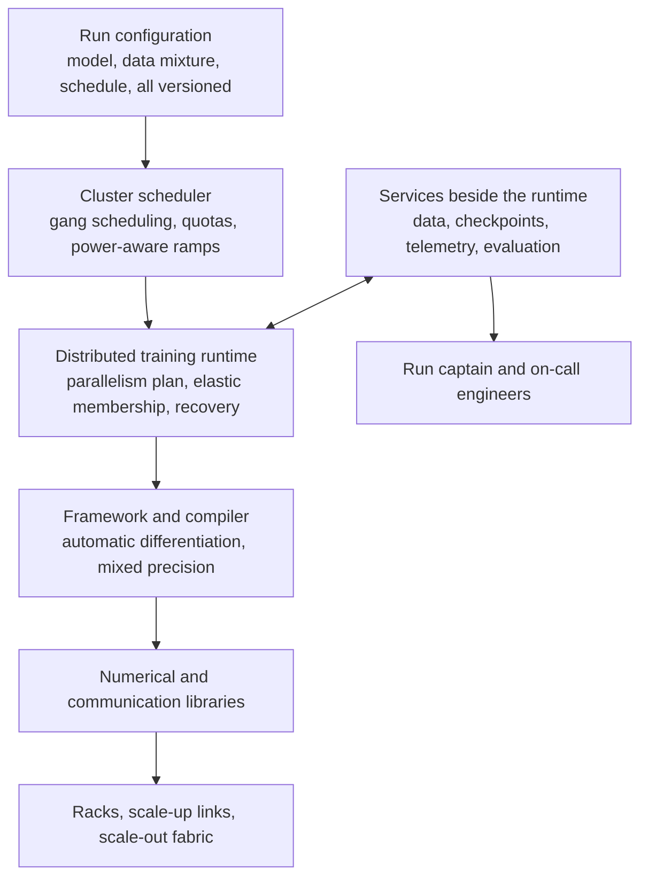
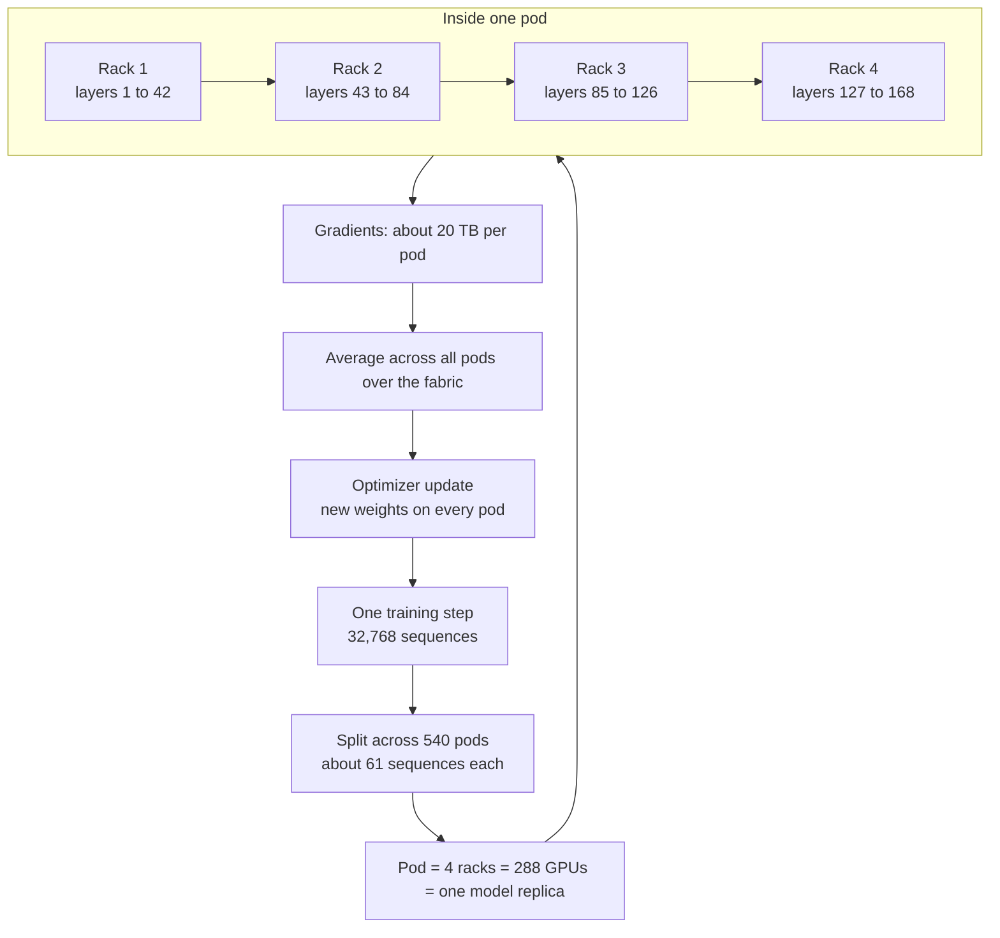
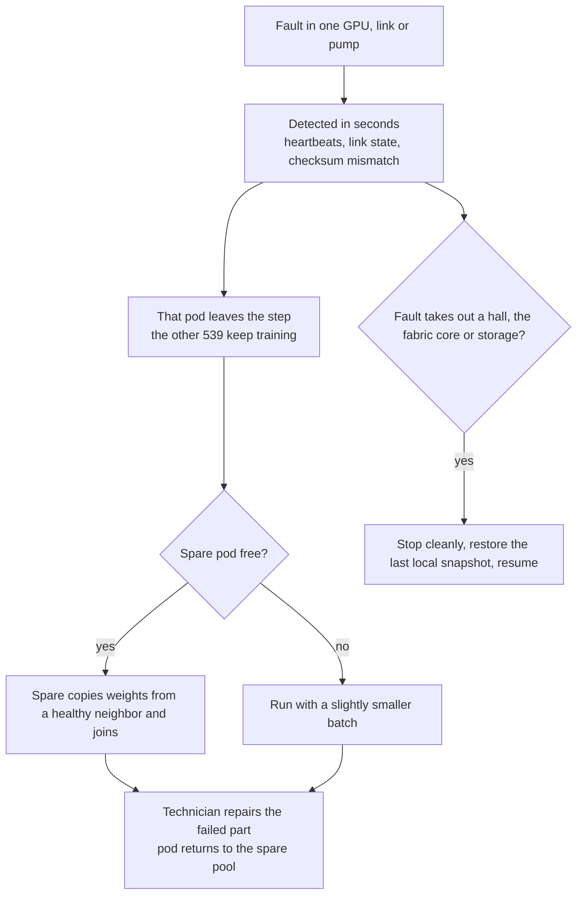

# 8. Training stack and the pretraining run

[Back to the overview](../README.md) · Previous: [7. Data center, power and cooling](07-data-center-power-and-cooling.md) · Next: [9. Post-training and fine-tuning](09-post-training-and-fine-tuning.md)

This chapter is the "harness" for training: the software that makes 155,520 GPUs behave like one computer for ten weeks, and the plan for the run itself. Hyperparameters here are illustrative starting points. The real values come out of the scaling ladder in 8.9.

## 8.1 The job on one page

| Item | Value |
|---|---|
| Model | About 10.1T parameters total, 1.6T active per token ([chapter 4](04-model-and-parameters.md)) |
| Data | 216T tokens |
| Compute | 2.06e27 FLOPs |
| Hardware assigned | Six halls at 80%: 155,520 GPUs, 60% of the finished campus |
| Throughput while running | About 41 million tokens per second |
| Step | 32,768 sequences of 8,192 tokens: 268 million tokens per step, about 6.6 seconds |
| Steps | About 805,000 |
| Wall-clock | About 72 days at 85% uptime; 90 days scheduled |
| Model copies training in parallel | 540 |
| Checkpoint | 20 TB weights only; about 100 TB with optimizer state |
| Something breaks | About every 17 minutes |

## 8.2 The stack

| Layer | Build or buy | Notes |
|---|---|---|
| Scheduler | Build on an open-source base | Must understand whole-job gangs, hall boundaries and power ramps |
| Training runtime | Build | The part no vendor sells at this scale. Owns placement, communication schedule and failure handling |
| Framework | Open source | A mainstream array framework with automatic differentiation |
| Kernels and communication libraries | Vendor, with in-house tuning | Performance engineering here is worth whole percentage points of a $58B campus. This plan does not specify it: it is measured and tuned on the real hardware |
| Data service | Build | Simple and critical |
| Checkpoint and evaluation services | Build | Tied to the safety gates |

## 8.3 How one model is spread over 155,520 GPUs

A full copy of the weights at 16-bit precision is about 20 TB, almost exactly the GPU memory of one rack. Training also needs gradients, activations and working space, so one copy of the model occupies a pod of four racks.

| Level | Scope | Link | How work is split | Count |
|---|---|---|---|---|
| 1 | GPUs inside a rack | Scale-up links | Large matrices are split across GPUs (tensor parallelism); experts are placed on different GPUs (expert parallelism) | 72 GPUs |
| 2 | Four racks: one pod | Scale-up inside, fabric between | The 168 layers are split into four consecutive stages, one per rack (pipeline parallelism) | 288 GPUs, 82.9 TB of GPU memory, one model replica |
| 3 | All pods | Scale-out fabric | Each pod processes a different slice of the batch (data parallelism); gradients are averaged across pods every step | 540 replicas |

### The network sets the pace

Each step, every pod must exchange a full set of gradients: about 20 TB. A pod's fabric bandwidth at 1.6 Tbit/s per GPU is about 57.6 TB/s, and an averaging round moves roughly two copies, so gradient exchange takes about 0.7 seconds of a 6.6-second step. With half the bandwidth it would take twice as long. That is the reason the plan uses large steps, the reason per-GPU fabric bandwidth matters as much as GPU arithmetic, and one reason real utilization sits far below the headline figure. Sending gradients at 8-bit precision would halve it again.

## 8.4 Precision

| What | Format | Why |
|---|---|---|
| Stored weights | 16-bit | Small updates must not be rounded away |
| Optimizer statistics | 32-bit | Numerically the most sensitive state |
| Most matrix multiplies | 8-bit floating point with per-tensor scaling | On this hardware the 8-bit peak is more than four times the 16-bit peak |
| Normalization, softmax, loss, router, embeddings | 16 or 32-bit | Sensitive to rounding |
| 4-bit arithmetic | Selected layers only, after validation on the pilot | The vendor headline figures assume it everywhere; the plan does not |

The planning rate of 2.5 PF per GPU assumes 8-bit-dominant mixed precision works at this scale. There is published support: DeepSeek-V3 ran its matrix multiplies at 8-bit with loss within 0.25% of a 16-bit reference, and a 2026 study trained a 12B model mostly at 4-bit with a loss gap of about 1%, keeping roughly a sixth of the layers at higher precision. Neither was at 10T parameters. If the pilot shows a problem, the fallback is the conservative case in [chapter 5](05-compute-cluster.md): about half the throughput, and a run of about five months instead of ten weeks.

## 8.5 Optimization recipe (starting point)

| Setting | Starting value |
|---|---|
| Optimizer | AdamW, decoupled weight decay 0.1, betas 0.9 and 0.95 |
| Peak learning rate | About 6e-5 |
| Schedule | Linear warm-up over the first 0.5% of steps, cosine decay to 10% of peak |
| Gradient clipping | Global norm 1.0 |
| Batch | Ramped from 34M to 268M tokens per step during the first 5% of training |
| Sequence length | 4,096 at first, 8,192 for the bulk, 32,768 and longer in the final 10% |
| Expert routing | Top-8 of 64 with an auxiliary load-balancing loss; router noise early |
| Regularization | No dropout |

Every value above is re-fitted at each rung of the ladder. At this scale a wrong learning rate is not a slow afternoon; it is a nine-figure mistake.

## 8.6 Feeding the run

41 million tokens per second sounds like a lot of data. As bytes it is about 160 MB/s, a fraction of what one modern solid-state drive can deliver. Training is limited by arithmetic and by gradient traffic, not by reading data.

| Requirement | Design |
|---|---|
| Exact reproducibility | Shard order is a pure function of the seed and the step number |
| Exactly-once on restart | The data position is saved in every checkpoint |
| Mixture control | Each step draws sources according to the versioned mixture recipe |
| Multimodal inputs | Video and audio are pre-tokenized offline ([chapter 3](03-data-pipeline.md)); the loader reads compact features |
| Local caching | Each rack keeps the next few minutes of data on local flash so a storage hiccup does not stall the step |

## 8.7 Staying up: fault tolerance

With 155,520 GPUs and their switches, optics, pumps and power shelves in one job, a hardware fault is expected about every 17 minutes ([chapter 14](14-people-and-organization.md) has the failure arithmetic). Published experience agrees: Meta projected a failure every 14 minutes for a job of 131,000 GPUs, and its 16,000-GPU Llama 3 run was interrupted 466 times in 54 days while still training more than 90% of the time. A design that restarts the whole job on each fault would never finish.

| Mechanism | Detail |
|---|---|
| Elastic data parallelism | A pod can drop out or rejoin between steps. Losing one pod shrinks the batch by 0.19% |
| Hot spares | 11 pods (2%) held ready |
| Fast rejoin | A returning pod copies 20 TB of weights from a neighbor over the fabric in under a minute |
| Local snapshots | Every 15 minutes each pod writes its state to local flash and mirrors it to a neighbor pod |
| Durable checkpoints | Weights every 30 minutes; full state (about 100 TB) every 2 hours, written to the flash tier in about a minute |
| Silent data corruption | Every few hundred steps two pods compute the same slice and compare checksums; outlier gradient norms are flagged per pod; suspect hardware is quarantined |
| Network faults | Adaptive routing around failed links; a pod with a degraded link is treated as failed |
| Automatic rollback | Loss spikes beyond a threshold trigger a rewind to the last good snapshot with a reduced learning rate, without waiting for a human |

### Where the 15% of lost time goes

| Loss | Budget |
|---|---|
| Start-up, ramp and early tuning | 5% |
| Recovery from faults and rollbacks | 5% |
| Planned maintenance windows | 3% |
| Checkpoint and evaluation pauses | 2% |
| **Total** | **15% (85% uptime)** |

## 8.8 Being a good neighbor to the power system

All pods compute and then all pods communicate, in lock-step. Left alone, the campus's power draw would swing by hundreds of megawatts several times a minute, which generators and grid operators cannot tolerate. The scheduler therefore treats power as a resource:

- Jobs ramp up and down at an agreed rate instead of stepping.
- Rack-level energy buffers and the site batteries absorb the fast swings ([chapter 7](07-data-center-power-and-cooling.md)).
- A power floor keeps draw from collapsing during communication phases and checkpoints.
- The plant operations desk is told before a large job starts, stops or restarts.

## 8.9 The scaling ladder

No one trains a 10-trillion-parameter model as their first attempt. Each rung is ten times the last, and each must land on the curve predicted from the rungs below before the next is funded.

| Rung | Model | Tokens | FLOPs | Where | Compute time | Month |
|---|---|---|---|---|---|---|
| 1 | 1B dense | 21.6B | 1.3e20 | Rented GPUs | Minutes | 3 |
| 2 | 10B dense | 216B | 1.3e22 | Rented GPUs | About 10 minutes on the full rented fleet | 5 |
| 3 | 100B: **first working model** | 2.2T | 1.3e24 | Rented GPUs (20,000) | About 18 hours | 9 |
| 4 | 1T pilot | 21.6T | 1.3e26 | Halls 1 and 2 | About 11 days | 14 to 16 |
| 5 | Dress rehearsal: flagship architecture | 20T | 1.9e26 | Halls 1 to 4 at half allocation | About 16 days | 18 to 20 |
| 6 | **Flagship** | 216T | 2.1e27 | Halls 1 to 6 at 80% | About 72 days | 22 to 25 |

The compute time of each rung is small. The calendar time is not, because each rung is run many times: architecture variants, data-mix ablations, precision sweeps, deliberate fault injection. Rungs 1 to 3 together are repeated hundreds of times and are where the recipe is actually decided.

## 8.10 Phases of the flagship run

| Phase | Share of tokens | What happens |
|---|---|---|
| 0 Burn-in | None | Three days. A small model runs across every pod to shake out bad hardware, cabling and storage paths |
| 1 Warm-up | First 1% | Short sequences, small batch, conservative precision, learning rate ramps |
| 2 Main | 1% to 90% | Full batch and mixed precision. Checkpoint evaluations at 10%, 25%, 50% and 75% |
| 3 Long-context and annealing | Last 10% | Longer sequences, highest-quality data, learning rate decays |
| 4 Handover | None | Final checkpoint sealed, hashed and transferred to the post-training enclave |

Dangerous-capability mini-suites run on a checkpoint every 5% of the run ([chapter 10](10-safety-guardrails-and-refusals.md), gate 2). If a threshold is crossed before its safeguards exist, the run pauses.

## 8.11 What is watched

| Signal | Why |
|---|---|
| Loss by data source | A source going wrong shows here before the average moves |
| Gradient and update norms per layer | Early sign of instability |
| Router entropy and expert load | Detects experts dying or hogging traffic |
| Activation statistics | Detects numerical drift from low precision |
| Throughput and utilization per pod | Finds slow hardware |
| Replica agreement checks | Finds silent corruption |
| Power, coolant temperatures, flow | Protects the plant |
| Checkpoint evaluation scores | The real measure of progress, and the safety gate |

## 8.12 People in the loop

| Role | Coverage |
|---|---|
| Run captain | One named person per shift with authority to pause, roll back or resume |
| On-call engineers | ML systems, cluster reliability, network, storage, facilities: around the clock |
| Research on call | For anything that looks like a modeling problem and not a systems one |
| Change control | No change to the recipe mid-run without sign-off from the run captain and the research lead |
| Daily review | Fifteen minutes: curves, faults, decisions |
