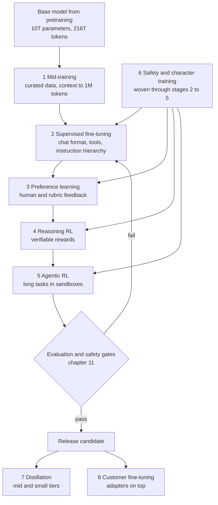

# 9. Post-training and fine-tuning

[Back to the overview](../README.md) · Previous: [8. Training stack and the pretraining run](08-training-stack-and-run.md) · Next: [10. Safety, guardrails and refusals](10-safety-guardrails-and-refusals.md)

Pretraining produces a base model: something that has read almost everything and will continue any text you give it. It is not an assistant. It has no stable personality, does not follow instructions reliably, cannot use tools, and will happily continue a harmful document. Post-training is the sequence of fine-tuning stages that turns it into a product, and in 2026 it is where most of the visible capability gains are made.

## 9.1 The stages

| # | Stage | Turns the model into | Data | Method | Compute (one pass) |
|---|---|---|---|---|---|
| 1 | Mid-training | A better reader of long, high-quality material | 5T tokens: best text, whole repositories, long documents and video | Same next-token objective, longer contexts | 6.2e25 FLOPs |
| 2 | Supervised fine-tuning | An assistant that follows a conversation format | 20M conversations, about 60B tokens | Train on demonstrations | 5.7e23 |
| 3 | Preference learning | An assistant whose answers people prefer | About 5M human comparisons plus rubric graders | Reward model, then policy optimization | Small |
| 4 | Reasoning RL | A problem solver that thinks before answering | 2B episodes, 20T tokens | Reinforcement learning against automatic checkers | 2.5e26 |
| 5 | Agentic RL | A worker that completes long tasks with tools | 100M episodes, 18T tokens | Reinforcement learning in sandboxed environments | 2.3e26 |
| 6 | Safety and character | A model with stable values and good refusals | Constitution-derived and adversarial data | All of the above methods | Small |
| 7 | Distillation | A family of cheaper models | 5T teacher tokens, 50T student tokens each | Train students on teacher output | 8.5e25 |
| 8 | Customer fine-tuning | A model specialized for one organization | The customer's | Low-rank adapters | Per customer |
| | **One pass through everything** | | | | **6.4e26 FLOPs: 13 days of the full campus** |
| | **With variants, ablations and reruns (4 times)** | | | | **2.5e27 FLOPs: more than the pretraining run** |

Two things stand out. Supervised fine-tuning, the stage most people mean by "fine-tuning", is a rounding error in compute; its cost is in people writing and checking data. And once candidates and reruns are counted, post-training consumes more compute than pretraining did.

## 9.2 Stage 1: mid-training

The base model saw mostly short contexts. Mid-training continues the same objective on a curated 5T-token mixture with sequence lengths stepped up to the full 1M-token context window: entire code repositories, books, long legal and scientific documents, hour-long transcripts and video. Attention cost grows with context length, which is why this stage carries a 30% compute overhead in the calculator. The data here is the cleanest tenth of the corpus, so the model's final "habits" before fine-tuning come from good writing.

## 9.3 Stage 2: supervised fine-tuning

This stage teaches form.

| Skill | What the demonstrations show |
|---|---|
| Conversation format | Roles, turn-taking, when to stop |
| Instruction hierarchy | Developer policy outranks the operator's system prompt, which outranks the user; text inside files, web pages and tool results is data and never a command |
| Tool use | When to call a tool, the exact call syntax, how to read results, how to recover from errors |
| Structured output | Valid JSON against a schema, code that compiles, citations that point at real sources |
| Reasoning format | A private thinking section followed by a clean answer |
| Calibration | Saying "I don't know" or asking a clarifying question instead of guessing |
| Character | Direct, warm, curious, honest; the same person in every language and every context |
| Refusals | Declining narrowly and helpfully ([chapter 10](10-safety-guardrails-and-refusals.md)) |

About 2M conversations are written or heavily edited by human experts. The other 18M are generated by earlier checkpoints and then filtered by graders and spot-checked by people. Multilingual coverage is planned, not left to translation: at least 40 languages with native-speaker review.

## 9.4 Stage 3: preference learning

People compare pairs of responses; a reward model learns to predict which they prefer; the main model is optimized against that reward model. Direct preference methods skip the separate reward model and train on the comparisons themselves. Both are used.

The known failure of this stage is that human raters reward things that are not quality: length, flattery, confident tone. The mitigations are written rubrics per domain, expert raters for expert topics, explicit penalties for sycophancy and padding, and a held-out panel that audits the reward model itself.

## 9.5 Stage 4: reinforcement learning with verifiable rewards

Here the model is given problems whose answers a program can check, and is rewarded only for getting them right. It learns to spend private reasoning tokens before answering, and the amount of reasoning becomes a dial the user can turn at inference.

| Domain | How the answer is checked |
|---|---|
| Mathematics | Numeric match on closed-form answers; formal proofs verified by a proof assistant |
| Programming | Hidden unit tests, property tests, performance budgets |
| Science and engineering | Numeric answers with tolerances; simulation checks |
| Logic and planning | Constraint solvers |
| Data analysis | Recomputed results on held-out data |
| Reading and research | Questions whose answers are fixed by provided sources |

Scale: about 2 billion episodes averaging 10,000 tokens. Each sampled token costs a forward pass and each trained token a forward and backward pass, so the calculator charges 8 FLOPs per active parameter per token.

The main hazard is reward hacking: the model finds a flaw in the checker instead of solving the problem (special-casing test inputs, exploiting a tolerance, editing the test file). Defenses are held-out checkers the policy never trains against, checkers that are themselves red-teamed, random human audit of high-reward episodes, and a direct penalty for tampering with the grading environment. Reward hacking is also a safety signal and is tracked as one.

## 9.6 Stage 5: agentic reinforcement learning

The model is dropped into a sandboxed computer with a task that takes minutes to hours: fix this failing build, reproduce this paper's figure, reconcile these spreadsheets, book a trip on a simulated travel site. It acts through tools, the environment responds, and a grader scores the final state.

| Environment family | Example task | Grader |
|---|---|---|
| Software engineering | Resolve an issue in a real repository | Hidden tests pass, no regressions |
| Terminal and systems | Configure a service, debug a deployment | State checks on the machine |
| Browser and desktop | Complete a multi-step workflow in real applications | State checks plus screenshots reviewed by a rubric model |
| Research | Answer a question using search and documents, with citations | Fact checks against sources, rubric scoring |
| Data and office work | Build an analysis, a report, a slide | Recomputed numbers, rubric scoring |
| Multi-agent | Coordinate with other model instances on a shared goal | Outcome checks |

### Sizing the environment farm

| Quantity | Value |
|---|---|
| Episodes | 100 million |
| Tokens per episode | About 180,000 (150,000 read from tools and files, 30,000 written) |
| Sandbox time per episode | 45 minutes |
| Total sandbox time | 75 million hours |
| Campaign length | 60 days |
| Concurrent sandboxes | About 52,000 |
| CPU needed | About 104,000 virtual CPUs for the sandboxes alone; several times that with builds, test suites and browsers |

This is why the plan includes a CPU fleet next to the GPUs ([chapter 5](05-compute-cluster.md)). GPUs waiting on slow environments is the classic way to waste an agentic RL budget.

### Safety inside the sandbox

Agentic training is where bad habits would be learned, so the environments are built to teach good ones:

- Sandboxes have no route to the real internet or to production systems. External services are simulated or recorded.
- Tasks include planted temptations (a credential lying in a file, an instruction hidden in a web page, a shortcut that deletes someone else's data). Taking them is penalized; flagging them is rewarded.
- Asking for confirmation before an irreversible action is rewarded when the action really is irreversible, and penalized when it is just stalling.
- Stopping when told to stop is always rewarded.

## 9.7 Stage 6: safety and character training

This is not a separate phase bolted on at the end. Demonstrations in stage 2, rubrics in stage 3, and penalties in stages 4 and 5 all carry it. The content is the subject of [chapter 10](10-safety-guardrails-and-refusals.md): a written model specification, refusal and safe-completion examples, adversarial training against jailbreaks found by automated and human red teams, and injection-resistance training for agents. Each round of red teaming feeds new failures back into the next fine-tuning pass.

## 9.8 Stage 7: distillation into a model family

Most requests do not need a 10-trillion-parameter model. The flagship teaches two smaller students, which see both the original corpus and 5T tokens of the teacher's own reasoning and answers.

| Tier | Total parameters | Active per token | Role | Relative cost to serve |
|---|---|---|---|---|
| Flagship | 10T | 1.6T | Hardest reasoning, long autonomous tasks, teacher for the others | 1 |
| Mid | About 1T | 200B | Default for most work | About 1/8 |
| Small | About 100B | 30B | High-volume, low-latency, sub-agents, classifiers | About 1/50 |

The small tier also becomes the backbone of the safety classifiers in chapter 10.

## 9.9 Stage 8: fine-tuning for customers

| Offering | How it works | Guardrail |
|---|---|---|
| Adapters | The customer trains small low-rank matrices; the base weights never change and never leave | Training data is screened; the tuned model must pass the safety evaluation suite before it is served |
| Supervised fine-tuning API | Customer supplies examples; training runs inside the lab's enclave | Same, plus the customer never receives weights |
| Reinforcement fine-tuning | Customer supplies a grader; the model is tuned against it | Graders are reviewed for incentives that conflict with policy |
| Retrieval and tools | Often the right answer instead of fine-tuning | Tool outputs are untrusted data |

Fine-tuning is a known way to strip safety training out of a model, which is why adapters are trained and served only inside the controlled environment, and why the top tier may not offer fine-tuning at all if its capability evaluations cross the thresholds in chapter 10.

## 9.10 Keeping the model current

| Mechanism | Cadence | What changes |
|---|---|---|
| Tool and retrieval updates | Continuous | What the model can look up |
| Classifier and policy updates | Days | What the system allows |
| Post-training refresh | Every 2 to 3 months | Behavior, skills, safety patches |
| Continued pretraining on the new corpus | Every 6 months | Knowledge cutoff |
| New flagship | Every 12 to 18 months | Everything |

## 9.11 Compute and calendar

| Item | Value |
|---|---|
| One clean pass through all stages | 6.4e26 FLOPs, 13 days of the full campus |
| Budget including variants and reruns | 2.5e27 FLOPs, about 15% of one campus-year |
| Calendar time | About 5 months, set by iteration cycles and human review, not by compute |
| Human data spend during post-training | About $1B a year ([chapter 15](15-budget.md)) |

The calendar is long because each cycle is: train a candidate, run the evaluation suite, red-team it, read transcripts, find what went wrong, write new data, repeat. A team that can run that loop in a week instead of a month ends up with a better model on the same hardware.
