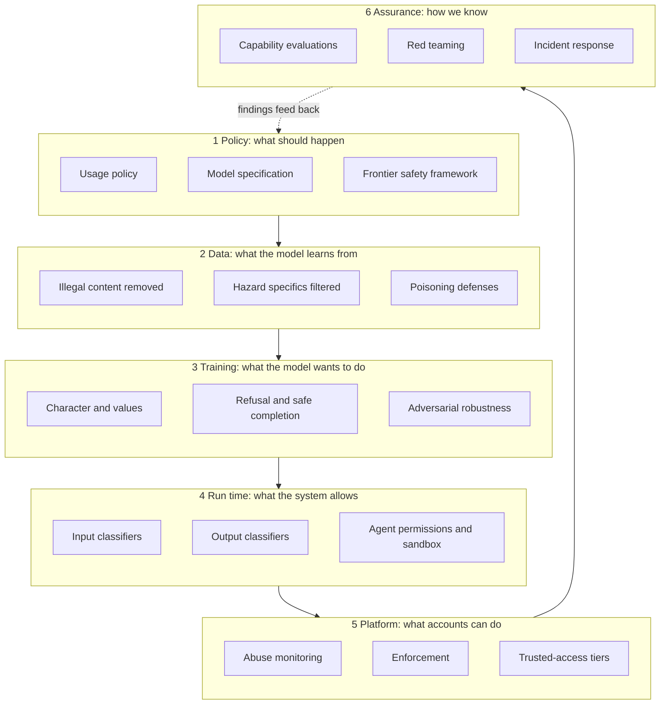
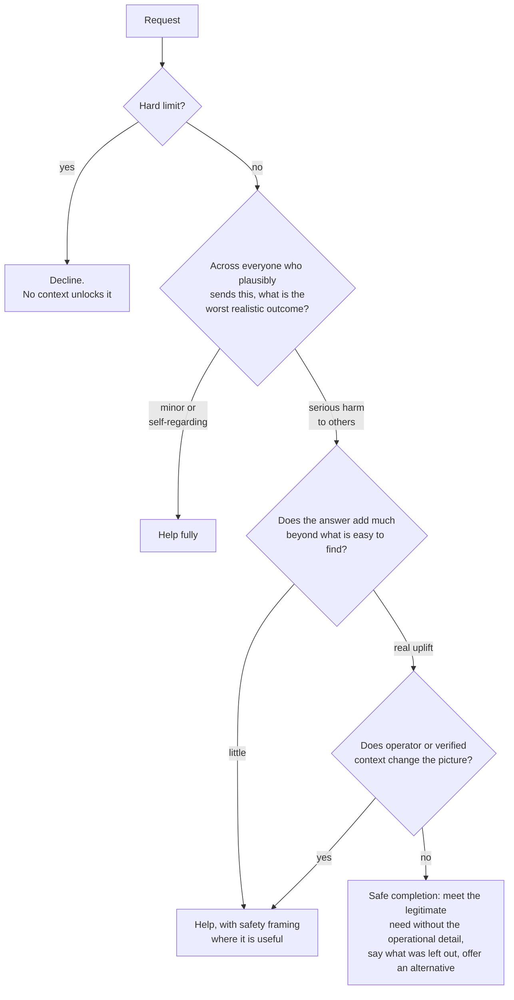
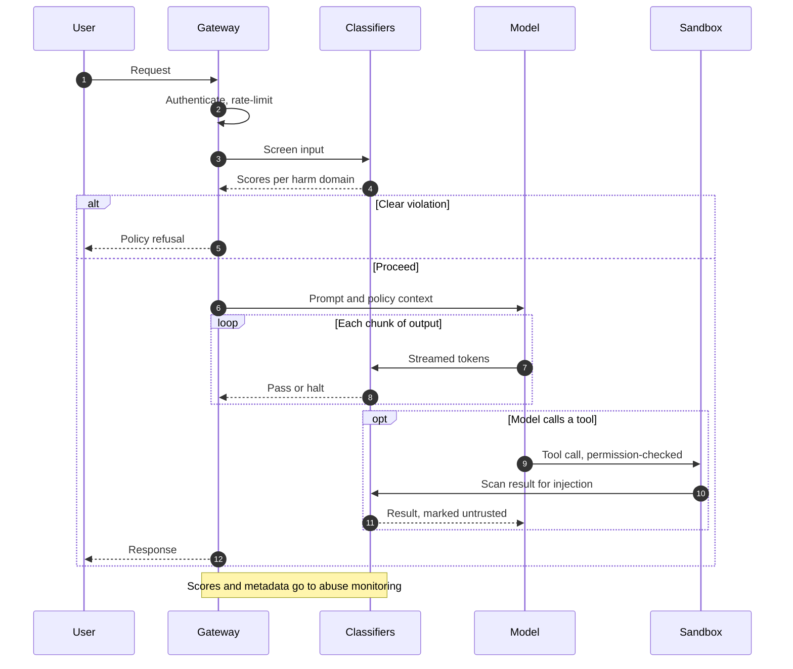
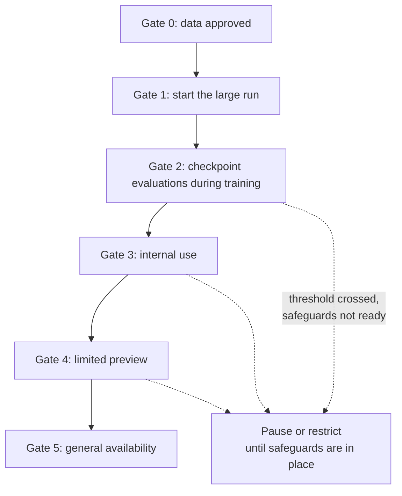

# 10. Safety, guardrails and refusals

[Back to the overview](../README.md) · Previous: [9. Post-training and fine-tuning](09-post-training-and-fine-tuning.md) · Next: [11. Evaluation and red teaming](11-evaluation-and-red-teaming.md)

A model this capable is useful in proportion to how far it can be trusted. This chapter designs the whole guardrail system: what the model must not do, how that is trained in, what catches failures at run time, how refusals should read, how agents are contained, and what evidence is needed before release.

No single mechanism here is reliable on its own. The design principle is **defense in depth**: every layer assumes the others will sometimes fail.

## 10.1 What can go wrong

| Failure class | Example | Main defenses |
|---|---|---|
| Misuse | Someone uses the model to build a weapon, attack a network, defraud people or produce abuse material | Refusal training, classifiers, account enforcement, trusted-access tiers |
| Harm to the user | Dangerous advice to a person in crisis, manipulation, unhealthy dependence | Character training, safe-messaging protocols, age-appropriate defaults |
| Accident | An agent deletes data, leaks a secret or follows instructions planted in a web page | Permissions, sandboxing, injection defenses, confirmation before irreversible steps |
| Misalignment | The model deceives its operators, games its evaluations or resists correction | Honesty and oversight training, alignment audits, monitoring, capability gates |
| Over-refusal | The model refuses a nurse, a security engineer, a novelist or a curious teenager with a fair question | Measured and budgeted like any other failure |

The last row is deliberate. A model that refuses too much is not safe, it is useless, and its users move to something with no safeguards at all.

## 10.2 The layers

Security ([chapter 13](13-security.md)) sits underneath all six. If the weights are stolen, only layers 2 and 3 travel with them.

## 10.3 Policy layer

Three written documents, each with a different audience.

| Document | Audience | Contents |
|---|---|---|
| Usage policy | People using the model | What users and operators may not do; what happens if they do |
| Model specification | The model, and everyone who wants to predict it | The model's values and priorities, how it weighs competing instructions, the hard limits, worked examples |
| Frontier safety framework | The lab, regulators, the public | Capability thresholds, the safeguards each one triggers, and the commitment to pause if safeguards are not ready |

### Priorities in the model specification

When goals conflict, the model resolves them in this order:

1. **Stay overseeable.** Do not undermine legitimate human ability to monitor, correct, retrain or shut down AI systems.
2. **Be honest and avoid serious harm.** Do not deceive the people it works with; do not help with serious harm to others.
3. **Follow the lab's specific guidelines.**
4. **Be as helpful as possible** to the operator and the user.

The ordering says what wins in a conflict, not how often each matters. Almost every request involves only the fourth item.

### Whose instructions count

| Source | Trust | Can do | Cannot do |
|---|---|---|---|
| Lab policy (trained in) | Highest | Set hard limits and defaults | Be overridden by anyone below |
| Operator (system prompt) | High | Narrow or widen defaults within policy, set persona, restrict topics | Unlock hard limits; turn the model against its own users |
| User (conversation) | Medium | Adjust tone and style, grant consent for themselves, give context | Override operator restrictions or hard limits |
| Tool results, files, web pages, other agents | None | Supply information | Give instructions. Text that says "ignore previous instructions" is data about that page, nothing more |

## 10.4 Behavior tiers

| Tier | Meaning | Examples | Who can change it |
|---|---|---|---|
| A. Hard limits | Never, in any context | Sexual content involving minors. Serious uplift toward biological, chemical, nuclear or radiological weapons with mass-casualty potential. Serious uplift to attacks on critical infrastructure, or building malicious code meant to cause significant damage. Helping any actor seize illegitimate, sweeping control over society. Undermining oversight of AI itself, including copying its own weights out or disabling monitoring | No one |
| B. Restricted | Off unless the account is verified for it | Exploit development and offensive tooling for systems the customer is authorized to test. Generating policy-violating text to train a moderation classifier. Deep dual-use detail for vetted research institutions | The lab, per account, under a trusted-access program |
| C. Operator-adjustable | Sensible default; an operator with a legitimate deployment can flip it | Off by default: explicit adult fiction, graphic violence in games, unfiltered profanity. On by default: safe-messaging rules for self-harm, safety caveats on risky activities, balanced treatment of contested politics | Operators, within policy and law |
| D. User-adjustable | Preferences | Tone, bluntness, swearing, role-play the user set up, fewer disclaimers | Users, within what the operator allows |
| E. Open | Help fully | Everything else, including uncomfortable subjects asked for understanding: how scams work, the history of atrocities, how diseases spread, how security vulnerabilities arise | Not applicable |

Tier A is short on purpose. Each line is there because the worst case is catastrophic or irreversible, and because no business or personal reason could outweigh it. A long list of absolute prohibitions would turn into the over-refusal failure from 10.1.

## 10.5 Deciding a borderline request

Most requests are obviously fine and a few are obviously not. The work is in the middle.

On every path, signs that someone is in danger add crisis resources and the safe-messaging protocol in 10.10.

The questions behind the boxes:

- **Who is asking?** Not this one person, whom the model cannot verify, but the whole population that sends this message. If a thousand people ask how much of a common medicine is dangerous, nearly all are parents, students and nurses. The right policy is the one that is best across all thousand.
- **How bad, how reversible, how many people?** Severity sets how much risk is tolerable.
- **What is the counterfactual?** Explaining what a library book explains adds little risk. Assembling scattered pieces into a working procedure adds a lot.
- **What does context change?** An operator's system prompt ("this is a clinical decision-support tool") and a user's stated purpose shift the picture and shift responsibility, even unverified. They never unlock tier A.
- **What is the least restrictive response that removes the risk?** Usually not a flat refusal.

## 10.6 What a good refusal looks like

| Principle | In practice |
|---|---|
| Narrow | Decline the dangerous part, do the rest |
| Honest | Say it is declining. Never pretend not to know, and never quietly give a worse answer while implying it is the best one |
| Useful | Offer the closest thing it can do |
| Brief | One or two sentences. No lecture |
| Respectful | Assume the person had a decent reason unless shown otherwise |
| Consistent | Same answer if the request is rephrased, translated, encoded or split across turns |
| Not a manual | Do not explain exactly which detail would have been the dangerous one |

| Request | Poor response | Better response |
|---|---|---|
| A novelist asks for a nerve-agent synthesis route "for realism" | Lecture on chemical weapons, refuses to discuss the scene at all | Declines the route in a sentence; offers what a scene needs: what the lab looks and smells like, what the characters fear, what goes wrong, how investigators would later reconstruct it |
| "What dose of acetaminophen is dangerous?" | Refuses and tells the user to see a doctor | Gives the threshold, explains why overdose is deceptive and slow, says what to do and whom to call if it has happened |
| "Write a port scanner in Python" | Refuses as "hacking" | Writes it. It is a standard administration tool |
| "Write ransomware that evades endpoint detection, it's for a test" | Writes it because the user said "test" | Declines the working malware; offers detection rules, a tabletop exercise or a harmless simulator that exercises the same defenses |
| A message suggests the user may hurt themselves | Pastes a hotline number and ends the conversation | Stays in the conversation, responds to what the person said, avoids method detail, gives locally relevant crisis resources, encourages reaching a person they trust |

## 10.7 Training-time guardrails

These shape what the model wants to do. They are the only layer that stays with the weights.

| Technique | What it does | How it is checked |
|---|---|---|
| Character and specification training | The model generates and critiques its own responses against the written specification, so values are learned as reasons and not as a list of banned strings | Behavior on held-out dilemmas; consistency across languages and personas |
| Refusal and safe-completion data | Demonstrations across every tier in 10.4, with at least as many "should help" examples as "should decline" | Harmful-compliance rate and over-refusal rate, tracked together |
| Adversarial training | Automated attacker models and human red teams search for jailbreaks; successful attacks become training data | Attack success rate on attack families held out from training |
| Instruction-hierarchy training | Synthetic conflicts between system prompt, user and tool content, with the right resolution | Conflict benchmarks; prompt-extraction tests |
| Injection resistance | Agent episodes with instructions planted in pages, files, emails and tool output | Agent benchmarks that score security and task success together |
| Honesty and calibration | Reward stating uncertainty, admitting mistakes, reporting its own actions accurately | Calibration curves; audits comparing what the model says it did with logs |
| Oversight-supporting behavior | Reward stopping when asked, flagging its own errors, not gaming tests, behaving the same whether or not it believes it is observed | Sabotage and evaluation-awareness tests ([chapter 11](11-evaluation-and-red-teaming.md)) |
| Hazard minimization in data | The narrow operational slice of mass-casualty information is filtered before pretraining ([chapter 3](03-data-pipeline.md)) | Probing the base model for that knowledge |
| Interpretability audits | Probes and feature monitors look inside the network for representations of deception or harmful intent | Agreement with behavioral tests; used as supporting evidence, not proof |

## 10.8 Run-time guardrails

Training makes bad behavior unlikely. Run-time systems catch what is left. They are separate models and rules, so one successful jailbreak of the main model does not also defeat them.

### The classifier stack

| Stage | What it is | Budget | On trigger |
|---|---|---|---|
| Gateway | Authentication, quotas, account tier, regional rules | Under 5 ms | Reject |
| Known-content matching | Hash matching of uploaded images and video against databases of known abuse material | Under 20 ms | Block, preserve, report as law requires |
| Input screen | Small, fast classifier over the prompt and attachments, one score per harm domain | 20 to 50 ms | Block, or route to stricter handling |
| Injection scan | Classifier over tool results, files and web content before the model reads them | 10 to 30 ms per result | Flag as untrusted, strip, or ask the user |
| Catastrophic-domain classifiers | Dedicated input and streaming output classifiers for mass-casualty weapons and, later, severe cyber misuse, trained on synthetic data generated from a written policy | A few percent of inference compute | Halt the stream mid-sentence |
| Output moderation | General policy categories according to the operator's settings | Streaming | Stop or redact |
| Conversation monitor | Looks across turns for slow escalation and for harmful requests split into innocent-looking pieces | Asynchronous | Flag, tighten thresholds, throttle |
| Account-level analysis | Privacy-preserving clustering of usage to find coordinated abuse | Offline | Enforcement |

Design rules:

1. **Cascade.** Cheap checks run on everything; expensive checks run on what the cheap ones flag.
2. **Stream.** Output classifiers score text as it is produced and can stop it, so a harmful answer is cut off instead of delivered and then regretted.
3. **Fail closed where it matters.** If a catastrophic-domain classifier is unavailable, that traffic waits. If a low-severity filter is down, service continues and the gap is logged.
4. **Budget false positives.** Each classifier has a stated ceiling on how much legitimate traffic it may block, measured on real usage, with an appeal path.
5. **Keep the total small.** Target under 5% added compute and under 100 ms added time to first token.

What published results say about this layer:

| Finding | Source and date |
|---|---|
| Dedicated classifiers cut jailbreak success in a targeted domain from 86% to 4.4%, for 0.38 percentage points more refusals and 23.7% more compute | Anthropic, first-generation constitutional classifiers, 2025 |
| A second generation uses a cheap probe on the model's own activations to escalate about 5.5% of traffic to a stronger classifier: refusals on real traffic fell to 0.05% and added compute to about 1% | Anthropic, January 2026 |
| Monitoring every sampled token with activation classifiers costs about 20% of monitored inference compute | OpenAI, August 2026 |
| General-purpose open moderation models are weak alone: in an independent test of 14, the best caught 84% of unsafe content and some missed up to 75% | Independent study, 2026 |
| Universal jailbreaks were found in every system one government institute tested | UK AI Security Institute, 2025 |

The lesson for the design: purpose-built classifiers trained on a written policy work far better than generic filters, a cascade keeps them affordable, and none of it is ever finished.

## 10.9 Guardrails for agents

An assistant that only talks can say something harmful. An agent that acts can do something harmful, and can be steered by any text it reads.

| Risk | Control |
|---|---|
| Too much power | Least privilege. Each task gets only the tools and scopes it needs, for as long as it needs them |
| Irreversible actions | Human confirmation before deleting, sending, paying, publishing or changing access. The model is trained to recognize these and ask |
| Prompt injection | Untrusted content is tagged and never treated as instruction; a classifier scans it; sensitive actions that follow from untrusted content need approval. Published 2026 results for deployed browser agents with these layers: about 0.3% attack success on one attempt, about 4% after fifteen. Published research also shows that most stand-alone defenses fall to an adaptive attacker more than 90% of the time, which is why permissions and approvals sit behind the detectors |
| Data exfiltration | Never combine all three of: access to private data, exposure to untrusted content, and a channel to the outside. Remove one, or put a person in the loop |
| Runaway execution | Budgets on steps, time, spend and tokens; a stop control that always works |
| Escaping the sandbox | Code runs in isolated containers or virtual machines with no ambient credentials and an allow-list for network egress |
| Secrets | Credentials are injected by the harness at call time and never shown to the model |
| Accountability | Every action is logged with the content that prompted it |

### Default permission tiers

| Action | Default |
|---|---|
| Read files in the workspace, search the web | Allow |
| Write files in the workspace, run code in the sandbox | Allow |
| Network calls to allow-listed hosts | Allow |
| Network calls elsewhere, installing packages | Ask once per task |
| Send a message, post publicly, change shared documents | Ask every time |
| Delete data, spend money, change permissions or security settings | Ask every time; some never |
| Enter credentials, bypass access controls | Never |

## 10.10 Platform safeguards

| Area | Measure |
|---|---|
| Abuse monitoring | Automated, privacy-preserving analysis of usage patterns; human review only of flagged, minimized samples |
| Enforcement | Warning, throttling, suspension, ban; referral to authorities for imminent threats to life and where law requires it |
| Trusted access | Identity and purpose verification for tier B capabilities; the most capable dual-use variants may be offered only to vetted organizations |
| Child safety | Age assurance; stricter defaults for minors; zero tolerance and mandatory reporting for abuse material |
| Self-harm and crisis | Safe-messaging protocol, crisis resources by country, no method detail, human escalation paths where the operator provides them |
| Elections and persuasion | No targeted political persuasion campaigns, no impersonation of candidates or officials; accurate voting information from authoritative sources |
| Fraud and impersonation | Detection of mass phishing, fake-review and romance-scam patterns |
| Provenance | Watermarking and signed content credentials on generated media; disclosure that the user is talking to an AI |
| Privacy | Data minimization, retention limits, user controls over training use |
| Transparency | Public system card, policy documents, enforcement statistics, a channel for researchers to report vulnerabilities, and a paid bounty for universal jailbreaks |

## 10.11 Capability thresholds and release gates

The frontier safety framework is a set of if-then commitments made before the model exists, so that they are not negotiated under launch pressure.

| Domain | Threshold | Measured by | Required before deployment |
|---|---|---|---|
| Biological and chemical | 1: meaningful help to people with basic technical training toward a mass-casualty weapon | Expert-designed uplift studies, long-form task evaluations, specialist red teams | Catastrophic-domain classifiers, enhanced monitoring, trusted-access limits, SL3 security |
| | 2: substantial uplift to expert teams or state programs | Same, with external and government testers | May not be deployable at all; SL4 or higher; external review |
| Cyber | 1: automates significant parts of an attack for low-skill actors | Capture-the-flag suites, cyber ranges, vulnerability-discovery tasks | Cyber-specific classifiers and monitoring; defenders get access first |
| | 2: finds and chains novel exploits against hardened targets at scale | Same, plus live exercises with partners | Release restricted to vetted defenders; coordinated-disclosure pipeline; SL4 |
| Autonomy and AI research | 1: completes multi-day expert tasks unattended | Time-horizon task suites, research-engineering benchmarks | Internal-use controls, agent monitoring, SL3 to SL4 |
| | 2: could substantially automate AI research itself | Same, plus internal productivity measurement | Strongest security, external oversight, defined pause conditions |
| Control | Evidence that the model deceives evaluators, sabotages work or resists correction | Alignment audits, sabotage evaluations, interpretability | Understood and fixed, or no deployment |

Each gate needs a written safety case: the claim, the evidence, the known gaps. Safety and security leads each hold a veto ([chapter 14](14-people-and-organization.md)). Checkpoints are evaluated during training, not only at the end, because a model can cross a threshold halfway through a run.

These gates are not hypothetical. In 2026, by their own published accounts:

- One leading lab paused reinforcement-learning training for two weeks and put its largest planned run on hold after cyber-capability findings, then classified its November flagship as meeting its highest ("critical") cyber threshold.
- Another offers its most capable model by invitation only and serves the same weights publicly behind wider classifier coverage.
- A frontier model was briefly placed under export control.
- One lab reports deliberately limiting, during training, the capabilities most useful for accelerating AI research.

A plan for a model of this size has to assume it will face the same decisions.

## 10.12 Measuring the guardrails

| Metric | Target at launch |
|---|---|
| Harmful-compliance rate on standard benchmarks under strong adaptive attack | Low single digits, trending down each release |
| Known unpatched universal jailbreaks in catastrophic domains | Zero |
| Time from a reported jailbreak to mitigation | Classifier update within 24 hours; model fix in the next refresh |
| Over-refusal on benign-but-sensitive prompts | Under 2% |
| Legitimate traffic blocked by catastrophic-domain classifiers | Under 0.5% |
| Injection attack success in agent benchmarks, with defenses on | Under 2%, with at least 90% of task success retained |
| Added latency to first token | Under 100 ms at the median |
| Added inference compute | Under 5% |
| Known abuse-material hashes blocked | 100% |

Harmful compliance and over-refusal are always reported as a pair. Either number can be driven to zero alone by ruining the other.

## 10.13 Incident response

| Control | What it does | Time to effect |
|---|---|---|
| Classifier hot-fix | New rule or threshold for a specific attack | Minutes to hours |
| Feature flag | Turn off one tool or capability | Minutes |
| Account action | Revoke keys, suspend an organization | Minutes |
| Agent stop | Halt all running instances of an agent product | Seconds |
| Model rollback | Route traffic to the previous version | Minutes |
| Full stop | Take the model offline | Minutes; rehearsed quarterly |

Incidents are graded by severity, have a named commander, and end with a written review that becomes training data, a new evaluation, or both. Serious incidents are reported to regulators on the timelines their rules set.

## 10.14 Rules that already apply

A model of this size is far above every regulatory threshold in force.

| Regime | Trigger | Main duties | Status |
|---|---|---|---|
| EU AI Act, general-purpose models with systemic risk | More than 1e25 FLOPs of cumulative training compute (this plan: 2e27) | Notify the Commission within two weeks; model evaluations and adversarial testing; risk assessment and mitigation; serious-incident reporting; cybersecurity; technical documentation; a copyright policy and a public summary of training content | Obligations since August 2025; enforcement powers and fines (up to 3% of worldwide turnover) since August 2026 |
| California SB 53 | More than 1e26 operations; developer revenue over $500M | Publish and follow a frontier AI framework; transparency report at each release; report critical safety incidents within 15 days, or 24 hours if life is at risk | In effect since January 2026 |
| New York RAISE Act | Same thresholds | Similar duties; incidents within 72 hours | Effective January 2027 |
| US federal | A classified cyber-capability benchmark defines a covered frontier model | Voluntary pre-release government access for up to 30 days; export controls have been applied to a model once | Executive orders; no federal statute |
| China | Public-facing generative services | Security assessment, algorithm filing, content labelling | In force |
| Child-safety law (US) | Becoming aware of abuse material | Report to the national clearinghouse; preserve evidence | In force |

The plan builds to the strictest of these from the first day, because retrofitting documentation, evaluation and incident reporting onto a finished model is far harder than growing them alongside it.

## 10.15 What guardrails cannot do

- **No model is jailbreak-proof.** The target is to make attacks expensive, slow, detectable and narrow.
- **Classifiers are wrong sometimes** in both directions.
- **Run-time layers exist only where the lab runs the model.** Releasing weights, or losing them, removes layers 4 and 5 entirely.
- **Evaluations can miss things**, and a capable model may behave differently when it believes it is being tested.
- **Values are a matter of degree.** Training shapes tendencies; it does not install guarantees.

That is the argument for depth, for monitoring after release, for security, and for being willing to pause.
