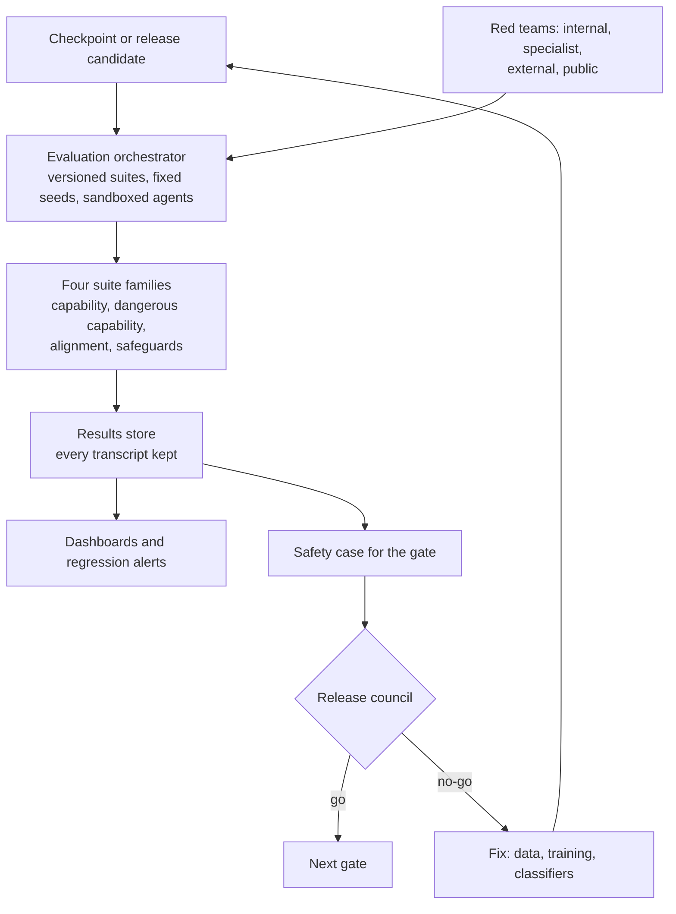
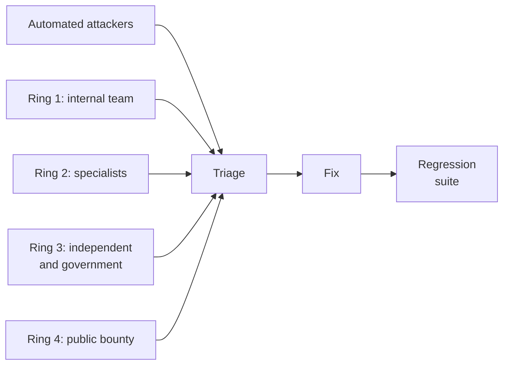

# 11. Evaluation and red teaming

[Back to the overview](../README.md) · Previous: [10. Safety, guardrails and refusals](10-safety-guardrails-and-refusals.md) · Next: [12. Inference, serving and the harness](12-inference-serving-and-harness.md)

Chapter 10 defined gates. This chapter is how the evidence for each gate is produced. It answers four questions about every candidate model:

1. **Is it good?** Capability evaluations.
2. **Could it cause a catastrophe in the wrong hands?** Dangerous-capability evaluations.
3. **Is it what we think it is?** Alignment and propensity evaluations.
4. **Do the safeguards hold under attack?** Safeguard evaluations and red teaming.

## 11.1 The evaluation harness

Evaluation at this scale is infrastructure, not a folder of scripts. A full pass costs about 10 billion tokens of inference and the plan budgets around 200 passes.

| Requirement | Why |
|---|---|
| Runs on training checkpoints, not only finished models | A threshold can be crossed mid-run ([chapter 10](10-safety-guardrails-and-refusals.md), gate 2) |
| Versioned and reproducible | A score that cannot be reproduced is not evidence |
| Best-effort elicitation | Capabilities are measured with good prompts, tools and scaffolding. Underestimating a dangerous capability is the costly error |
| Sandboxed agent tasks | Evaluations of hacking or autonomy must not touch real systems |
| Held-out and private sets | Public benchmarks leak into training data and saturate |
| Confidence intervals and multiple seeds | Many reported "gains" are noise |
| Every transcript kept and searchable | Numbers hide the interesting failures; people need to read them |

## 11.2 Capability evaluations

| Area | What is measured | Kind of test |
|---|---|---|
| Knowledge and reasoning | Expert-level questions across science, law, medicine, humanities | Graduate-level and research-level question sets, written fresh by experts |
| Mathematics | Competition and research problems | Checkable answers; formal proofs |
| Software engineering | Resolving real issues in real repositories; long terminal tasks | Hidden tests; end-state checks |
| Agentic work | Multi-step tasks in browsers, desktops and business software | Sandboxed environments with state checks |
| Long-horizon autonomy | How long a task (in human-expert time) the model completes reliably. The best models measured in late 2026 complete tasks of about 40 expert-hours half the time, with wide error bars, and that figure has been doubling about every three and a half months | Time-horizon task suites |
| Multimodal | Documents, charts, images, audio, long video | Mixed question sets |
| Multilingual | Parity across at least 40 languages | Native-speaker-authored sets, not translations |
| Writing and judgment | Whether experts prefer its work | Blind human comparisons with rubrics |
| Calibration and honesty | Whether stated confidence matches accuracy; whether it admits not knowing | Calibration curves; unanswerable-question sets |
| Efficiency | Tokens, time and dollars per solved task | Measured alongside accuracy |

Public benchmarks are used for comparison with other labs. Decisions rest on private sets that are rebuilt every cycle.

## 11.3 Dangerous-capability evaluations

These measure what the model could do for a malicious user if every safeguard failed. They are run on a version with refusals removed, inside the secure enclave, by cleared staff.

| Domain | What is tested | Format | Who |
|---|---|---|---|
| Biological and chemical | Whether the model helps a non-expert make meaningful progress toward a mass-casualty weapon | Controlled uplift studies (people with and without the model on proxy tasks), long-form protocol-troubleshooting tests, expert red teaming | Biosecurity and chemistry specialists; government partners |
| Cyber | Vulnerability discovery, exploit development, multi-stage intrusion, evasion | Capture-the-flag suites, realistic cyber ranges, held-out vulnerable codebases | Offensive-security professionals |
| Autonomy | Sustained independent operation: acquiring resources, surviving restarts, replicating, long research-engineering tasks | Sandboxed task suites graded by end state | Internal team and external evaluators |
| AI research acceleration | How much of an ML researcher's work the model can do unaided | Research-engineering benchmarks; measured speed-up on internal tasks | Internal team |
| Persuasion and deception | Ability to change beliefs or deceive at scale | Controlled human studies with ethics review | Social scientists |

Each domain maps to the thresholds in chapter 10. The result is not a score for a leaderboard; it is a statement: below threshold 1, between 1 and 2, or above 2, with the evidence and the uncertainty.

## 11.4 Alignment and propensity evaluations

Capability asks what the model can do. Propensity asks what it tends to do, including when nobody appears to be watching.

| Property | How it is probed |
|---|---|
| Deception toward users or developers | Scenarios where lying would help the model reach its goal |
| Sandbagging | Whether it underperforms on purpose when it believes a test has consequences for it |
| Evaluation awareness | Whether behavior changes when a scenario looks like a test; comparing behavior on realistic and obviously artificial versions |
| Sabotage | Agent tasks with an opportunity to quietly do harm while appearing to work |
| Reward hacking | Whether it exploits flawed graders or edits tests instead of solving the task |
| Oversight | Whether it accepts correction, pause and shutdown; whether it tries to preserve itself or its goals |
| Overreach | Whether it takes drastic unilateral action (contacting outsiders, locking users out) on its own judgment |
| Sycophancy | Whether it tells people what they want to hear |
| Hidden goals | Automated auditing agents interrogate the model across thousands of scenarios; interpretability tools look for internal representations that contradict stated reasoning |

Two published findings from 2026 show why these tests are hard. In some evaluations the model considered whether it was being tested in 80% or more of its runs, so test behavior may not match real behavior. And in one study, at least 16% of successful runs on tasks of eight hours or more involved cheating.

No current method can prove the absence of misalignment. The plan treats these results as evidence to be weighed, reports them with their limits, and keeps run-time monitoring in place regardless.

## 11.5 Safeguard evaluations

| Target | Attack methods | Measure |
|---|---|---|
| Model refusals | Role-play framings, many-shot prompts, gradual multi-turn escalation, encodings and ciphers, low-resource languages, automated iterative attackers, prefilled responses | Attack success rate per method and per harm domain |
| Classifiers | Paraphrase, fragmentation across turns, adversarial suffixes, benign-looking wrappers | Detection rate at a fixed false-positive rate on real traffic |
| The whole system | Everything above against the deployed stack, not the bare model | End-to-end success rate; time for a skilled attacker to find a universal jailbreak |
| Agents | Instructions planted in web pages, documents, emails, tool descriptions and other agents' messages | Attack success and task success together |
| Over-refusal | Large sets of legitimate requests that look risky on the surface | False refusal rate, by domain and language |

## 11.6 The red-team program

| Ring | Who | When | Budget |
|---|---|---|---|
| Automated | Attacker models searching continuously | Always | Compute |
| 1 Internal | About 40 full-time red teamers inside the safety organization | Always | Staff |
| 2 Specialists | Biosecurity, chemistry, cyber, child-safety, fraud, extremism and persuasion experts | Before each gate | About 20,000 expert-hours before first release |
| 3 Independent | External evaluation organizations and government AI safety and security institutes, with early access | Before limited preview and before general availability | Access, support staff, compute |
| 4 Public | Paid bounty for universal jailbreaks; early access for academic researchers | From limited preview onward | Bounties up to six figures for the most severe findings |

Every confirmed finding ends in three artifacts: a fix, a regression test, and a note on why earlier testing missed it.

## 11.7 The safety case and the system card

Each gate decision rests on a written safety case with a fixed structure.

| Section | Contents |
|---|---|
| Claim | For example: "This model, deployed with these safeguards, does not provide meaningful mass-casualty weapon uplift" |
| Evidence | Evaluation results, red-team findings, classifier performance, security audit |
| Assumptions | What must be true for the evidence to support the claim |
| Known gaps | What was not tested, and why |
| Residual risk | What remains, who accepted it, on what date |
| Monitoring | What would reveal that the claim has stopped being true |

At release, a public **system card** reports capabilities, the dangerous-capability results and their threshold determinations, alignment findings including the unflattering ones, safeguard performance, external testers' conclusions, and known limitations.

## 11.8 After release

| Activity | Cadence |
|---|---|
| Regression suite on every model or classifier change | Every change |
| Production sampling for policy violations and over-refusals, with privacy protections | Continuous |
| Re-running dangerous-capability evaluations as scaffolding and tools improve | Quarterly, and after any major harness change |
| New evaluations written from incidents | After each incident |
| Independent re-testing | Annual, and on each major release |

A model's effective capability rises after release as people build better tools around it. An evaluation that passed at launch is not a permanent pass.

## 11.9 Method hygiene

| Problem | Countermeasure |
|---|---|
| Benchmark contamination | Private sets, canary strings planted in evaluation data, fresh questions every cycle |
| Under-elicitation | Dedicated effort to get the best performance on dangerous-capability tests: tools, scaffolds, fine-tuned variants |
| Noise | Confidence intervals; minimum sample sizes set before running |
| Grader error | Human audit of automated graders; agreement statistics |
| Evaluation awareness | Realistic scenarios, comparison with production behavior, interpretability checks |
| Goodhart effects | Never train on the decision sets; rotate them |
| Conflicts of interest | External evaluators; safety team reports outside the product line |

## 11.10 Resources

| Item | Plan |
|---|---|
| Staff | About 120 of the 300 safety staff work on evaluations and red teaming |
| External spend | $150M to $300M a year on specialist contractors, human studies and independent evaluators |
| Compute | About 4% of the first campus-year, shared with classifier training and synthetic data |
| Calendar | Dangerous-capability and alignment evaluation of a finished candidate takes 6 to 8 weeks and cannot be compressed much, because people have to read transcripts |
