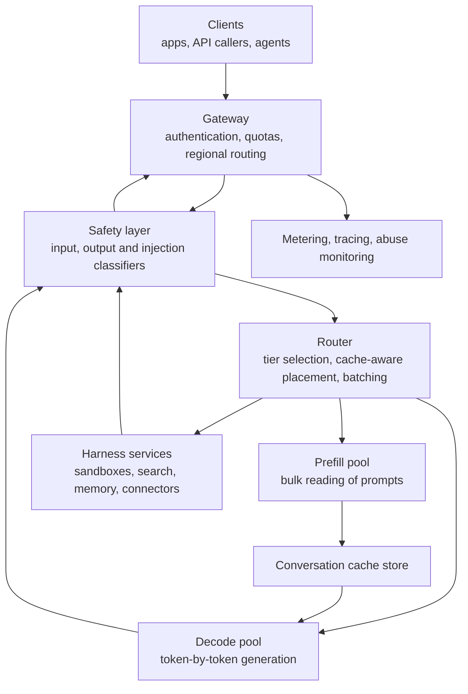
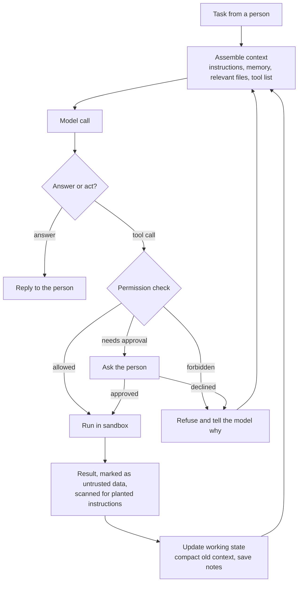

# 12. Inference, serving and the harness

[Back to the overview](../README.md) · Previous: [11. Evaluation and red teaming](11-evaluation-and-red-teaming.md) · Next: [13. Security](13-security.md)

Training makes the model once. Serving runs it billions of times. This chapter covers how fast the finished model can write (tokens per second), what a token costs, how the serving system is built, and the harness that turns a model that answers into an agent that works.

The speed and cost figures here are bounds and planning values computed from hardware specifications in [`calc/sizing.py`](../calc/sizing.py). They are not measurements. Real systems land below the bounds, sometimes far below, until a lot of engineering has been done.

## 12.1 From a checkpoint to a served model

| Step | What happens |
|---|---|
| Quantize | Weights go from 16-bit to 8-bit or 4-bit. The 10T-parameter flagship shrinks from about 20 TB to about 5 TB |
| Verify | The quantized model must match the original on the full capability and safety regression suites. Refusal behavior is checked specifically, because quantization can shift it |
| Seal | Weights are hashed, signed and encrypted for the inference enclave ([chapter 13](13-security.md)) |
| Place | One rack holds one copy of the flagship with room for conversation caches. Smaller tiers pack many copies per rack |
| Canary | A small share of traffic first; automatic rollback on regression |

## 12.2 How fast: tokens per second

Two physical limits set the speed of a large model on a rack.

- **Compute bound.** Each generated token costs about 2 FLOPs per active parameter. Divide the rack's arithmetic rate by that and you get total tokens per second across all users.
- **Memory-bandwidth bound.** To produce one token for a batch of users, the rack must read every weight the batch touches. Divide the rack's memory bandwidth by the size of the weights and you get the maximum number of generation steps per second, which is the ceiling on how fast any single user's text can appear.

For one rack (72 GPUs, 2.5 EF of dense 4-bit compute, 20.7 TB of GPU memory, about 1.4 PB/s of memory bandwidth):

| Model | Active parameters | Weights at 4-bit | Compute bound, whole rack | Planning throughput, whole rack | Bandwidth bound, one stream | Planning speed, one stream |
|---|---|---|---|---|---|---|
| Flagship (10.1T total) | 1.6T | 5.1 TB | 790,000 tok/s | **119,000 tok/s** | 277 tok/s | **About 90 tok/s** |
| Dense alternative (6.1T) | 6.1T | 3.0 TB | 208,000 tok/s | 31,000 tok/s | 462 tok/s | About 150 tok/s |
| Mid tier (1T total) | 200B | 0.5 TB | 6.3M tok/s | 945,000 tok/s | 2,800 tok/s | Capped near 400 tok/s by per-token overheads |
| Small tier (100B total) | 30B | 0.05 TB | 42M tok/s | 6.3M tok/s | Not the limit | Capped near 400 tok/s |

Planning values take 15% of the dense 4-bit peak and one-third of the bandwidth-bound step rate. Both derates are judgment calls that the pilot must replace with measurements.

What the table says in plain terms:

- One user of the flagship sees roughly **90 tokens per second**, about 70 words a second.
- One rack serves about **1,300 simultaneous flagship conversations** at that speed.
- Per-user speed depends on how many bytes of weights the rack must read for each step, so the smaller dense model is somewhat faster for one user. It serves about a quarter as many users per rack.

For comparison, independent measurements in November 2026 put today's flagship models at 43 to 112 output tokens per second and small tiers at 150 to 250. Specialized inference hardware is much faster: one vendor reports 750 tokens per second serving a frontier model and about 3,000 on a 120B open model. A premium fast tier would put the token-by-token decode step on that kind of hardware.

### Reading is faster than writing

Input tokens (the prompt, files, tool results) are processed in parallel and are limited only by compute, so a rack reads far faster than it writes. In agent workloads input outnumbers output by ten to one or more. Two techniques keep that affordable:

| Technique | Effect |
|---|---|
| Prompt caching | The internal state for a prefix that has been seen before (system prompt, tool definitions, a long document) is stored and reused instead of recomputed |
| Separating prefill from decode | Different rack pools handle bulk reading and token-by-token writing, each batched for its own bottleneck |

### Memory for long conversations

Every token in a conversation leaves a cache entry in every layer. The flagship's architecture keeps that entry small on purpose ([chapter 4](04-model-and-parameters.md)):

| Quantity | Value |
|---|---|
| Cache per token | About 0.34 MB |
| Cache for a typical 20,000-token conversation | About 7 GB |
| Cache for a full 1M-token context | About 344 GB |
| Rack memory left after weights | 15.7 TB |
| Conversations that fit at typical length | About 2,300 |
| Conversations that fit at full context | About 46 |

Million-token contexts are possible and expensive. They are priced accordingly.

## 12.3 What a token costs

| Cost component, one rack position, one year | $M |
|---|---|
| Rack, depreciated over 4 years | 2.12 |
| Facility share, depreciated over 15 years | 0.29 |
| Electricity, 250 kW at PUE 1.15 and $68/MWh | 0.17 |
| Operations and maintenance | 0.20 |
| **Total** | **2.79** |

| Model | Tokens per rack-day at 50% average load | Hardware cost per million output tokens |
|---|---|---|
| Flagship | 5.1 billion | **About $1.50** |
| Dense alternative | 1.3 billion | About $5.70 |
| Mid tier | 41 billion | About $0.19 |
| Small tier | 270 billion | About $0.03 |

These are hardware costs at the planning derates, before research amortization, safeguards, staff, support, idle capacity and margin. They are also sensitive: halve the utilization or the achieved throughput and the cost doubles.

| If average load is... | Flagship cost per million output tokens |
|---|---|
| 25% | About $3.00 |
| 50% | About $1.50 |
| 75% | About $1.00 |

For scale, list prices in November 2026 run from about $40 per million output tokens for the top tier of the leading labs, through $10 for mid tiers, to $0.50 for the smallest. Hardware is a minority of the price of a frontier token; the research behind it is the rest.

## 12.4 Sizing the serving fleet

| Item | Value |
|---|---|
| Racks assigned to the flagship at launch | 500 (125 MW, 14% of the campus) |
| Average output | About 30 million tokens per second |
| Daily output | About 2.6 trillion tokens |
| Simultaneous conversations at planning speed | About 650,000 |
| Remaining inference capacity | Mid and small tiers, batch jobs, internal use, reinforcement-learning rollouts |

For scale, Google reports its APIs processing nearly 32 billion tokens a minute across all its models, input and output together: about 46 trillion a day.

The first-year compute budget in [chapter 4](04-model-and-parameters.md) leaves about 36% of a campus-year for inference. After launch the campus is mainly an inference plant, and inference regions closer to users are added on rented capacity.

## 12.5 Serving architecture

| Technique | Purpose |
|---|---|
| Continuous batching | New requests join a running batch at each step instead of waiting for the next one |
| Cache-aware routing | A follow-up turn goes to the rack that already holds its conversation cache |
| Expert-aware batching | Requests are grouped so a batch touches fewer experts, cutting memory traffic for the sparse flagship |
| Speculative decoding | The small tier drafts several tokens; the flagship verifies them in one step |
| Priority classes | Interactive traffic ahead of batch; batch soaks up idle capacity at a discount |
| Tiered routing | Easy requests go to cheaper tiers when the caller allows it |
| Graceful degradation | Under overload: shed batch, shorten reasoning budgets, fall back a tier, queue; never drop the safety layer |
| Multi-region | At least three serving regions; any one can be lost |

| Service target | Value |
|---|---|
| Availability | 99.9% monthly for the API |
| Time to first token, interactive | Under 1 second at the median, including safeguards |
| Output speed, flagship | About 90 tokens per second |
| Rollback | Previous model version kept warm for 30 days |
| Deprecation | Published retirement dates; at least 6 months' notice |

## 12.6 The harness

A model on its own produces text. The harness is the software that gives it a loop, tools, memory and limits, and it accounts for a large part of what the system can actually do. The same model in a good harness finishes tasks that it abandons in a poor one.

| Component | What it does | Why it matters |
|---|---|---|
| Context manager | Decides what goes into the window each turn; summarizes and compacts old turns; retrieves files and notes on demand | A 1M-token window still fills up on a day-long task |
| Memory | Durable notes the agent writes for itself and for future sessions, visible to and editable by the user | Continuity without stuffing everything into context |
| Tool layer | Code execution, file system, web search and fetch, browser and desktop control, connectors to business systems through an open tool protocol | Tools are how the model checks its own work |
| Sandbox | Isolated containers or virtual machines with no ambient credentials and an allow-list for network access | Containment ([chapter 10](10-safety-guardrails-and-refusals.md)) |
| Permission system | The tiers in chapter 10: allow, ask once, ask every time, never | Keeps people in charge of irreversible steps |
| Planner and sub-agents | A lead agent splits work, hands pieces to parallel workers on cheaper tiers, and checks their results | Parallelism and cost control |
| Checkpoints and undo | Every file change and action is recorded and reversible where the world allows | Makes mistakes cheap |
| Budgets | Limits on steps, time, tokens and spend, with a stop control that always works | Prevents runaways |
| Tracing | Every model call, tool call and decision is logged in a readable trace | Debugging, evaluation, accountability |
| Evaluation hooks | The same harness runs the agent benchmarks in [chapter 11](11-evaluation-and-red-teaming.md) | What is tested is what ships |

Harness design principles:

1. **Give the model ways to verify.** Running the tests, re-reading the file, checking the page loaded. An agent that can check its work corrects most of its own errors.
2. **Keep instructions and data apart.** Everything that arrives through a tool is data, labeled as such.
3. **Prefer reversible actions**, and ask before the ones that are not.
4. **Spend the expensive model where it matters.** Planning and judgment on the flagship; searching, reading and routine edits on the small tier.
5. **Leave a trail** a person can audit in minutes.

## 12.7 Product surface

| Surface | For | Notes |
|---|---|---|
| Chat application | Everyone | Projects, files, memory, connectors, voice and vision |
| API | Developers | Messages, tools, structured outputs, caching, batch, files, streaming |
| Agent toolkit | Developers building agents | The harness above as a library |
| Coding agent | Engineers | Terminal and editor integration; runs tests; opens pull requests |
| Enterprise | Organizations | Single sign-on, audit logs, data residency, retention controls, admin policy |
| Fine-tuning | Organizations | Adapters, served inside the enclave ([chapter 9](09-post-training-and-fine-tuning.md)) |

## 12.8 What changes with the dense alternative

If the program trains the dense 6T option instead, serving changes in one way that matters: each rack serves about a quarter as many users, so the same demand needs four times the racks and the hardware cost per million output tokens rises from about $1.50 to about $5.70. Per-user speed is somewhat higher. That cost is still well inside top-tier prices, which is why the option is real and not only theoretical.
