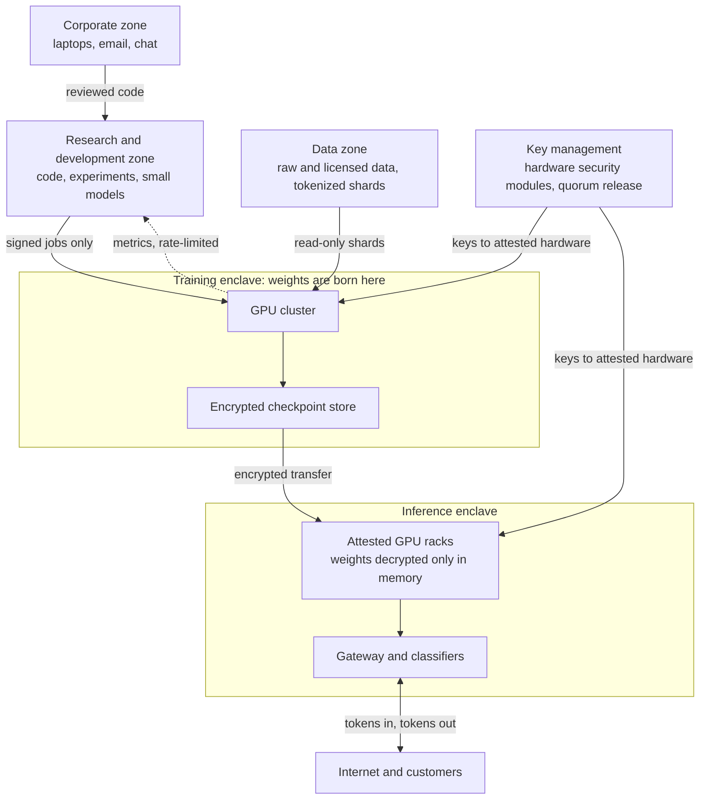

# 13. Security: protecting the weights, the data and the campus

[Back to the overview](../README.md) · Previous: [12. Inference, serving and the harness](12-inference-serving-and-harness.md) · Next: [14. People and organization](14-people-and-organization.md)

The finished weights are a 20-terabyte file that cost tens of billions of dollars to produce and can be copied in an afternoon. Guardrails are worthless if the model can be stolen and run without them. Security is therefore part of the safety case, not a separate concern.

## 13.1 What is being protected

| Asset | Why it matters | Size |
|---|---|---|
| Model weights (flagship and checkpoints) | Whoever holds them has the model without its safeguards | About 20 TB at 16-bit, 5 TB at 4-bit |
| Training recipes and code | Years of research compressed into configuration files | Small; easy to leak |
| Licensed and personal data | Contractual and legal duties; people's privacy | Hundreds of PB |
| User conversations | Trust; legal duties | Grows with use |
| The cluster itself | Hijacked compute trains someone else's model or attacks someone else's network | 259,200 GPUs |
| Safety systems | A tampered classifier or evaluation is worse than none | Small; integrity matters more than secrecy |

## 13.2 Who the adversaries are

RAND's 2024 study *Securing AI Model Weights* defines five attacker classes and five matching security levels. The plan uses that scale because it is public and specific.

| Level | Defends against | Typical attacker | Target date in this plan |
|---|---|---|---|
| SL1 | Amateur attempts | Hobbyist hackers | Day 1 |
| SL2 | Professional opportunistic attacks | Individual professionals | Month 6 |
| SL3 | Cybercrime syndicates and insider threats | Organized groups, corrupt insiders | Before the pilot run (month 14) |
| SL4 | Standard operations by leading state programs | Well-resourced intelligence services | Before flagship weights exist (month 22) |
| SL5 | Top-priority operations by the most capable states | The best attackers in the world | Roadmap only: not achievable today without years of work and government help |

Two cautions. No lab publicly attests that it has reached any of these levels, and one leading lab's own 2026 risk report calls theft of its weights by a well-resourced state "highly plausible". RAND's 2026 follow-up lists 262 controls for SL3 alone and estimates 6 to 12 months to implement them. Reaching SL4 in 22 months from a standing start is a best-case target.

Being honest about SL5 matters. If evaluations show the model crossing the highest capability thresholds in [chapter 10](10-safety-guardrails-and-refusals.md) before SL5 is reachable, the framework's answer is to pause or restrict, not to hope.

## 13.3 Trust zones

The corporate zone has no route to weights at all. Researchers do not log in to machines that hold plaintext weights; they submit signed jobs and read metrics.

## 13.4 Controls

| Area | Control | Purpose |
|---|---|---|
| Weights at rest | Encrypted with keys held in hardware security modules; release needs a quorum of key holders | A stolen disk is noise |
| Weights in use | Confidential computing on the accelerators: weights are decrypted only inside attested hardware | A compromised host operating system cannot read them |
| Human access | No individual can read plaintext weights. Any action touching them needs two authorized people and leaves a tamper-evident log | Limits insider theft and coercion |
| Egress from the training enclave | A hard daily byte budget far below the size of a checkpoint; every flow inspected; no direct internet route | Turns theft from minutes into months, which is long enough to notice |
| Interfaces | Narrow, purpose-built APIs for checkpoints, evaluation and fine-tuning instead of general shell access | Shrinks the attack surface |
| Hardware supply chain | Secure boot, firmware attestation, tamper-evident seals, random teardown inspections, vetted integrators | Implants are the route a top-tier attacker would choose |
| Software supply chain | Signed and reproducible builds, dependency review, isolated build systems | A poisoned library is the cheapest way in |
| Network | Zones separated physically where possible; management network isolated; default deny between zones | Stops lateral movement |
| Endpoints | Managed devices, hardware security keys, no long-lived credentials | Most intrusions begin with one phished laptop |
| Insider risk | Background checks, least privilege, separation of duties, behavior analytics, a confidential reporting channel | Insiders are the most likely real-world path |
| Physical | Double perimeter, vehicle barriers, mantraps, biometric access by zone, caged halls, continuous video, escorted vendors | See 13.6 |
| Detection and response | Security operations center staffed around the clock, deception assets (canary weights and credentials), rehearsed weight-theft response | Assume prevention fails somewhere |
| Testing | Standing internal red team, external penetration tests, a paid vulnerability disclosure program | Find it before others do |

### The egress budget, worked

A 4-bit copy of the flagship is about 5 TB. If the training enclave may send out at most 50 GB a day in total (metrics, logs, evaluation results), then even an attacker who captures the whole allowance needs 100 days to move one copy, and any large deviation trips an alarm on day one. The inference enclave cannot use a byte cap because its legitimate output is large: at fleet scale it emits many terabytes of tokens a day. There the control is structural: weights exist in plaintext only inside attested memory, and the only thing allowed out is sampled tokens.

## 13.5 Threats specific to AI systems

| Threat | What it looks like | Mitigation |
|---|---|---|
| Model extraction through the API | Millions of queries used to train a copy ("distillation attack") | Rate limits, account verification, detection of systematic harvesting patterns, legal terms, output watermarking |
| Prompt injection against internal agents | A document or web page instructs an internal AI agent to leak data | Internal agents get least privilege and no route to weights; tool outputs are treated as data ([chapter 10](10-safety-guardrails-and-refusals.md)) |
| The model as an insider | A capable model with internal access acts against its instructions | Monitoring of agent actions, sandboxing, no self-modification rights, evaluations for sabotage and self-exfiltration |
| Data poisoning | Planted documents create a backdoor | Source trust tiers and checkpoint backdoor scans ([chapter 3](03-data-pipeline.md)) |
| Evaluation tampering | Someone alters a safety test or its results | Integrity controls, independent replication, signed results |
| Compute hijacking | Stolen credentials used to run unauthorized training | Job signing, per-team quotas, anomaly detection on usage |

## 13.6 Physical security of the campus

| Layer | Measure |
|---|---|
| Site | Stand-off distance from public roads, double fence with intrusion detection, vehicle barriers at the single staffed entrance |
| Buildings | No external signage, hardened shells, loading docks separated from halls |
| Halls | Biometric plus badge mantraps, access by named hall, cages around network cores and key management rooms |
| People | Guards across all shifts, visitor escort, vendor vetting, device controls in sensitive rooms |
| Media | Storage devices never leave whole: destroyed on site |
| Utilities | Substations, fuel and coolant plant inside the perimeter; two separate fiber routes; drone detection |

## 13.7 Security gates

Security milestones are entry conditions for the program gates in [chapter 16](16-timeline.md).

| Gate | Security condition |
|---|---|
| Start of pilot training | SL3 controls audited by an external assessor |
| Start of flagship training | Training enclave operating at SL4; egress budget enforced; key quorum live |
| Internal use of the flagship | Insider-risk program fully staffed; agent monitoring in place |
| External release | Inference enclave attested end to end; extraction detection live; incident response rehearsed |

## 13.8 Cost and friction

| Item | Estimate |
|---|---|
| Security staff | 180 ([chapter 14](14-people-and-organization.md)) |
| Share of program budget | 3 to 5% including hardware features, guards and tooling |
| Productivity cost | Real. Researchers lose shell access to production weights and wait for two-person approvals. The plan accepts this and invests in tooling to keep the wait short. |
