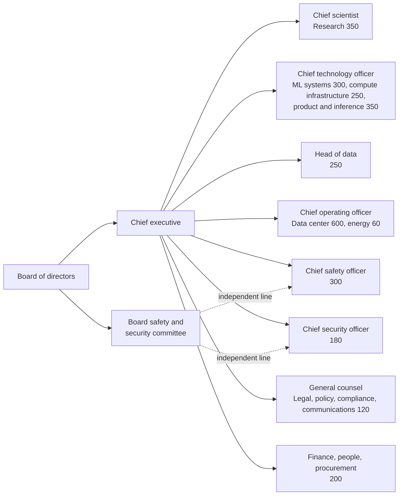
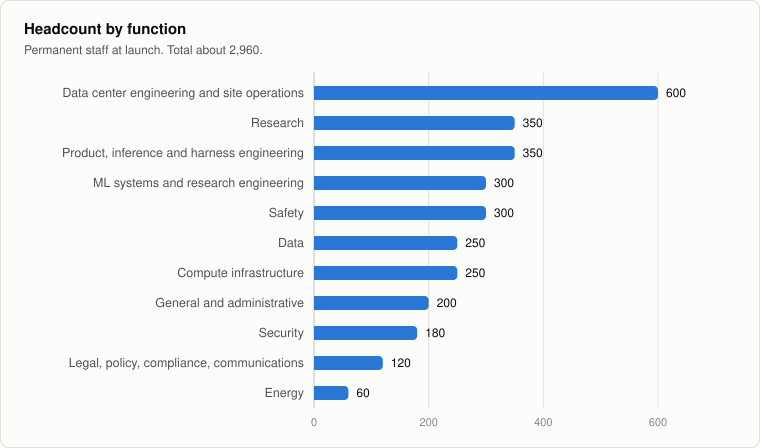

# 14. People and organization

[Back to the overview](../README.md) · Previous: [13. Security](13-security.md) · Next: [15. Budget](15-budget.md)

A frontier model is built by three workforces that barely overlap: the permanent organization that designs, trains and operates it, the construction workforce that builds the campus, and the contracted experts who write, rate and attack data. This chapter sizes all three.

## 14.1 The three workforces

| Workforce | Size | Employer | When |
|---|---|---|---|
| Permanent organization | About 2,960 at launch | The lab | Ramps over 36 months |
| Construction and commissioning | About 6,000 at peak | General contractor, trades, equipment vendors | Months 3 to 24 |
| Human-data contractors | 10,000 to 30,000 part-time annotators and domain experts | Data vendors | Month 6 onward |

## 14.2 Organization chart

Safety and security report to the chief executive and have a direct line to a board committee. They can stop a release without going through the people whose schedule a stop would hurt.

## 14.3 Headcount by function

<picture>
  <source media="(prefers-color-scheme: dark)" srcset="../diagrams/headcount-dark.svg">
  
</picture>

| Function | Staff | Loaded cost per head | Annual cost | What they do |
|---|---|---|---|---|
| Research | 350 | $2.2M | $0.77B | Pretraining science, architecture, optimization, multimodal, reasoning and reinforcement learning, evaluation science |
| ML systems and research engineering | 300 | $1.2M | $0.36B | Distributed training runtime, performance engineering, data loaders, fault tolerance, experiment tooling |
| Data | 250 | $0.7M | $0.17B | Crawl and ingest, pipeline, quality research, licensing and partnerships, annotation operations, privacy |
| Compute infrastructure | 250 | $0.8M | $0.20B | Cluster reliability, scheduler, network, storage, hardware engineering, capacity planning |
| Data center engineering and site operations | 600 | $0.3M | $0.18B | Design and construction oversight; round-the-clock facilities, hardware repair, logistics, physical security |
| Energy | 60 | $0.5M | $0.03B | Power procurement, grid interconnection, plant oversight, trading and hedging |
| Safety | 300 | $1.2M | $0.36B | Safeguards engineering, alignment science, interpretability, red team, frontier-risk evaluations, usage policy and enforcement |
| Security | 180 | $0.7M | $0.13B | Information security, weights protection, insider risk, physical security, detection and response |
| Product, inference and harness | 350 | $0.9M | $0.32B | Serving stack, API, agent harness, developer platform, applications, support engineering |
| Legal, policy, compliance, communications | 120 | $0.7M | $0.08B | Copyright and licensing, privacy, regulatory filings, government affairs, public reporting |
| General and administrative | 200 | $0.4M | $0.08B | Finance, recruiting, people operations, procurement, workplace, internal IT |
| **Total** | **2,960** | | **$2.68B** | |

For comparison, published 2026 figures put Anthropic at about 5,300 staff, OpenAI at about 4,500 and heading for 8,000, and Mistral between 1,000 and 1,600. Those companies run many models and products; this organization builds one.

Loaded cost covers salary, equity, benefits and overhead. The average here is about $0.9M a head; one leading lab's filings imply about $1.3M. The research figure is an average over a distribution with a long tail: a few dozen people at the top cost eight figures a year each, and their judgment is worth it because one wrong architectural bet wastes a billion dollars of compute.

## 14.4 Ramp

| Function | Month 6 | Month 12 | Month 24 | Month 36 |
|---|---|---|---|---|
| Research | 40 | 120 | 250 | 350 |
| ML systems and research engineering | 30 | 100 | 220 | 300 |
| Data | 40 | 150 | 230 | 250 |
| Compute infrastructure | 20 | 80 | 200 | 250 |
| Data center engineering and site operations | 30 | 100 | 450 | 600 |
| Energy | 10 | 30 | 50 | 60 |
| Safety | 20 | 80 | 200 | 300 |
| Security | 15 | 60 | 140 | 180 |
| Product, inference and harness | 5 | 30 | 150 | 350 |
| Legal, policy, compliance, communications | 15 | 50 | 90 | 120 |
| General and administrative | 25 | 80 | 150 | 200 |
| **Total** | **250** | **880** | **2,130** | **2,960** |

Data and legal ramp first because data collection and licensing have the longest lead time that money cannot shorten. Site operations ramp last because there is nothing to operate until halls are energized. Safety and security are staffed before the first large training run, not after.

## 14.5 First 30 hires

The first people decide everything that follows. In rough order:

1. Chief scientist and three or four senior researchers who have each led a frontier pretraining run.
2. Head of ML systems who has run training on more than 10,000 GPUs.
3. Head of data center development with a delivered campus of at least 300 MW.
4. Head of energy with utility-scale interconnection experience.
5. Head of data and a head of licensing partnerships.
6. General counsel with copyright and AI-regulation depth.
7. Chief security officer with experience against state-level adversaries.
8. Chief safety officer and leads for evaluations, safeguards and alignment.
9. Head of supply chain to secure accelerator, transformer and turbine allocations.
10. Leads for networking, storage, cluster reliability, evaluation infrastructure and recruiting.

## 14.6 Running the campus around the clock

The campus never stops, so site operations are staffed in four rotating crews.

| Role | Per hall, per shift | Halls | Crews | Staff |
|---|---|---|---|---|
| Critical-facilities technicians (electrical, mechanical, controls) | 6 | 8 | 4 | 192 |
| Hardware technicians (tray, cable, optics, coolant-line swaps) | 10 | 8 | 4 | 320 |
| **Hall subtotal** | | | | **512** |
| Campus operations center and engineering | | | | 40 |
| Logistics, spares, burn-in lab | | | | 25 |
| Environment, health and safety | | | | 10 |
| Site management | | | | 13 |
| **Site operations total** | | | | **600** |

Design and construction oversight is staffed from the same 600 during the build and converts to operations as halls hand over. Physical guarding (about 80 officers across shifts) and on-site power plant operation (about 45) are contracted and sit outside this count; the lab's own physical-security leadership is in the security organization.

### Why 320 hardware technicians

At this scale something is always broken. With about 259,200 GPUs, 3,000 fabric switch chassis, about two million optical lanes and tens of thousands of pumps, valves and power shelves, the expected workload is well over a hundred repair tickets a day:

| Component | Count | Assumed annual failure rate | Failures per day |
|---|---|---|---|
| GPUs (replaced as trays) | 259,200 | 3% | About 21 |
| Optical transceivers and co-packaged optical engines | About 2.1M | 1% | About 57 |
| Fiber links needing cleaning, reseating or replacement | About 1.04M | 1% | About 28 |
| Power shelves, pumps, leak sensors, drives | Hundreds of thousands | 1 to 2% | About 30 |
| **Total** | | | **About 140 a day, with bursts several times higher in the first months** |

Eighty technicians on shift at four to six tickets each gives headroom for the early-life burst, when failure rates are several times the steady state. The training software in [chapter 8](08-training-stack-and-run.md) is designed so that none of these failures stops the run.

## 14.7 Construction workforce

| Trade | Peak |
|---|---|
| Electrical (medium voltage, busway, controls) | 2,200 |
| Mechanical and piping (coolant loops, dry coolers) | 1,600 |
| Civil, structural, steel, concrete | 1,200 |
| Low voltage, fiber, rack integration | 600 |
| Commissioning agents and vendor field engineers | 250 |
| Site management, safety, logistics | 150 |
| **Total at peak** | **About 6,000** |

Skilled electricians are the binding constraint in every current build region. The plan assumes travelling crews, on-site housing and a training pipeline with local colleges started in month 1.

## 14.8 Human-data workforce

| Stream | People | Typical work | Typical rate |
|---|---|---|---|
| General annotation | 10,000 to 20,000 part-time | Rating responses, comparing pairs, labelling safety categories | $15 to $40 an hour |
| Domain experts | 3,000 to 8,000 part-time | Writing and grading hard problems in medicine, law, mathematics, science, finance, software | $50 to $200 an hour |
| Software task authors | 1,000 to 2,000 | Building realistic coding and agent tasks with tests | $60 to $150 an hour |
| Specialist red teamers | 200 to 500 | Biosecurity, chemistry, cyber, child safety, fraud, persuasion | Contract |

These are human beings doing work that is sometimes distressing. The plan budgets for fair pay, exposure limits and rotation for harmful-content review, counselling access, and the right to decline a task. It is the right thing to do and it also produces better data.

## 14.9 Governance bodies

| Body | Members | Decides |
|---|---|---|
| Board safety and security committee | Independent directors, external experts | Whether capability thresholds were crossed; whether required safeguards are in place |
| Release council | Research, safety, security, legal, product leads | Go or no-go at each gate in [chapter 16](16-timeline.md); safety and security each hold a veto |
| Compute council | Research, ML systems, infrastructure leads | Who gets how much of the cluster, weekly |
| Data council | Data, legal, privacy, safety leads | Which sources enter the corpus and on what basis |
| Incident command | Rotating on-call leads | Outages, security events, harmful-output incidents |

## 14.10 What makes this hard

1. **The people who have done this number in the low hundreds worldwide.** Money alone does not hire them; mission, compute access and colleagues do.
2. **Research and operations run on different clocks.** Researchers want to change everything weekly; a 1 GW campus wants nothing to change. The compute council exists to referee that.
3. **Safety staff need real authority.** A safety team that can only advise is a communications team.
