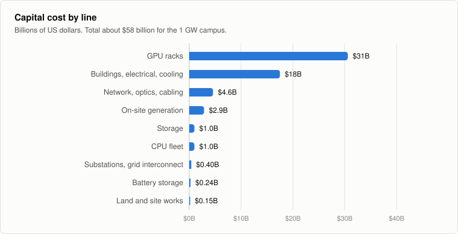

# 15. Budget

[Back to the overview](../README.md) · Previous: [14. People and organization](14-people-and-organization.md) · Next: [16. Timeline](16-timeline.md)

All figures are planning estimates in 2026 US dollars, produced by [`calc/sizing.py`](../calc/sizing.py). Financing costs and contingency are listed separately at the end.

## 15.1 The total

| | $B |
|---|---|
| Capital cost of the campus | 58.3 |
| Operating cost before launch (32 months) | 12.1 |
| **Program total to general availability** | **70.4** |
| Operating cost per year after launch, before depreciation | 7.0 |

## 15.2 Capital cost

<picture>
  <source media="(prefers-color-scheme: dark)" srcset="../diagrams/capex-dark.svg">
  
</picture>

| Line | $B | Basis |
|---|---|---|
| GPU racks | 30.6 | 3,600 at $8.5M. Analyst estimates run from $6M to $9.1M a rack |
| Scale-out network, optics, cabling | 4.6 | 15% of rack cost |
| Storage | 1.0 | Flash tier and object store |
| CPU fleet | 1.0 | About 20,000 servers for data processing and agent sandboxes |
| **IT hardware** | **37.2** | |
| Buildings, electrical, cooling | 17.5 | $17.5M per MW of IT |
| On-site generation | 2.9 | 1.3 GW at $2,200 per kW |
| Battery storage | 0.2 | 800 MWh at $300 per kWh |
| Substations and grid interconnect | 0.4 | |
| Land and site works | 0.15 | |
| **Facility and power** | **21.1** | |
| **Total** | **58.3** | **$58B per GW of IT; about $225,000 per GPU** |

### How that compares with published estimates

| Source | Figure |
|---|---|
| NVIDIA, August 2026: its own content in a gigawatt of this generation | About $40B |
| NVIDIA's chief executive, 2025 to 2026: a gigawatt "AI factory", all-in | $50B to $60B |
| Morgan Stanley, July 2026: per gigawatt for this generation | $49B |
| Foxconn's chairman, June 2026: a 1 GW site with up to 3,557 racks | Up to $47B |
| Morgan Stanley and Cushman & Wakefield, 2026: facility only | $16M to $19M per MW; $17.6M average |
| Epoch AI model for the previous rack generation | $37.9B per GW |

This plan is inside the published range and toward its upper end, because it owns 1.3 GW of generation and carries two power paths.

## 15.3 Operating cost

### Per year once running

| Line | $B per year | Basis |
|---|---|---|
| People | 2.68 | 2,960 staff ([chapter 14](14-people-and-organization.md)) |
| Data licensing | 1.50 | Publishers, forums, media libraries, pay-per-crawl ([chapter 2](02-data-sources.md)) |
| Hardware maintenance and spares | 1.12 | 3% of IT hardware |
| Human data | 1.00 | Annotation, expert tasks, environments, red-team vendors |
| Electricity | 0.69 | 10.1 TWh at $68/MWh, full load |
| **Total** | **7.0** | |

People cost four times as much as electricity. Depreciation is larger than everything in the table: IT hardware written off over four years is $9.3B a year, and the facility over fifteen years is $1.4B.

### Before launch

| Line | $B over 32 months | Why it is not 32 months of the full rate |
|---|---|---|
| Data licensing | 3.75 | Deals start in month 2; 2.5 full-rate years |
| People | 3.64 | Headcount ramps from 0 to 2,960; equivalent to 1.36 full-rate years |
| Human data | 2.00 | Starts in month 6 |
| Rented compute | 1.50 | About 20,000 GPUs for research before the first halls are live |
| Hardware maintenance and spares | 0.67 | Hardware arrives from month 11 |
| Electricity | 0.51 | Load ramps from month 12 |
| **Total** | **12.1** | |

## 15.4 Spend by year

| | Year 1 (months 0 to 12) | Year 2 (months 12 to 24) | Year 3 (months 24 to 32) | Total |
|---|---|---|---|---|
| Capital: long-lead deposits, site, halls 1 and 2 | 11.0 | | | |
| Capital: halls 3 to 6, racks for halls 1 to 6 | | 31.0 | | |
| Capital: halls 7 and 8, remaining racks | | | 16.3 | 58.3 |
| People | 0.45 | 1.40 | 1.79 | 3.64 |
| Data licensing | 1.00 | 1.50 | 1.25 | 3.75 |
| Human data | 0.30 | 0.90 | 0.80 | 2.00 |
| Rented compute | 0.60 | 0.90 | | 1.50 |
| Electricity and maintenance | | 0.32 | 0.86 | 1.18 |
| **Total** | **13.4** | **36.0** | **21.0** | **70.4** |

More than half the money is committed in year 2, before the pilot model has shown whether scale pays off as predicted. That timing is the core financial risk and the reason halls are phased.

## 15.5 What a training run costs

Running the campus costs about $12.5B a year in hardware terms (depreciation, electricity, maintenance), or about $34M a day.

| Run | Full-campus days | Cost of campus time |
|---|---|---|
| Pilot (1T, dense) | 2.7 | About $95M |
| Flagship pretraining | 43 | About $1.5B |
| Post-training, all variants | 54 | About $1.8B |
| Research experiments in year one | 91 | About $3.1B |

The famous "cost of the training run" is about 2% of the program. The rest buys the ability to do the run at all.

## 15.6 Sensitivities

| If... | Then |
|---|---|
| Racks cost $6M instead of $8.5M | Capital falls by $9.0B |
| Racks cost $9.1M | Capital rises by $2.2B |
| Facility costs $19M per MW instead of $17.5M | Capital rises by $1.5B |
| Power costs $100/MWh (Virginia or Ohio) instead of $68 | Electricity rises from $0.69B to $1.0B a year |
| The grid arrives on time and on-site generation is cut to a 400 MW bridge | Capital falls by about $2.0B |
| The schedule slips 12 months | About $5B to $7B more operating cost, plus financing |
| Sustained training rate is the conservative 1.2 PF per GPU | No change in spend; the flagship run takes five months instead of ten weeks |

## 15.7 Not included

| Item | Rough size |
|---|---|
| Contingency on construction and power (15%) | $3.2B |
| Interest during construction | $4B to $5B at typical rates on the average balance |
| Serving regions outside the campus after launch | Rented; scales with demand |
| Legal reserves for data disputes | Unknown; one 2025 settlement over pirated books reached $1.5B |
| Taxes, incentives and local agreements | Site-specific |

## 15.8 Scale check

The total is large and not unusual. One leading lab reported $18.8B of compute and infrastructure expense in the first nine months of 2026, and the largest technology companies each guide to $135B to $205B of capital spending for the year. A single 1 GW campus with a new lab around it is one entry ticket, not the whole game.
