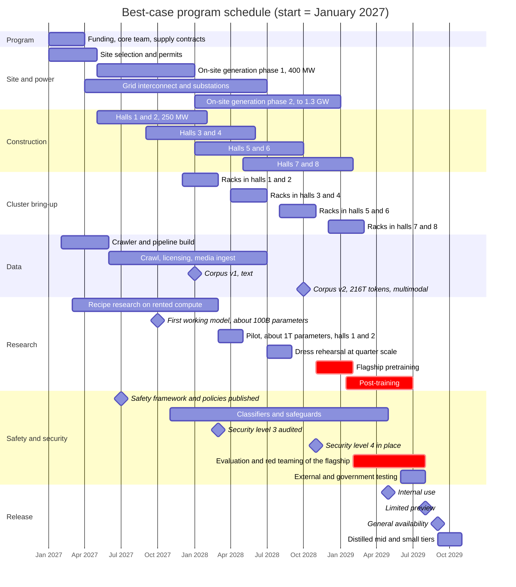
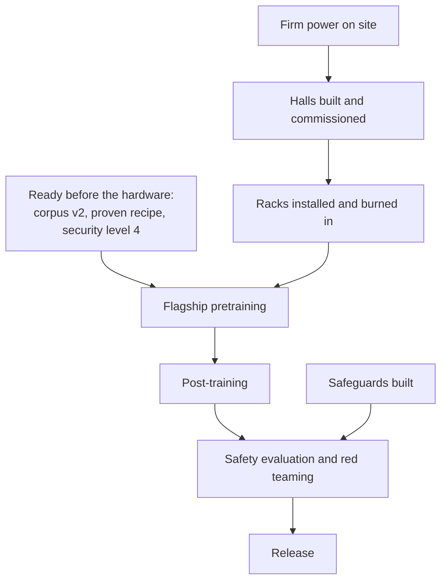

# 16. Timeline: from no model to a released model

[Back to the overview](../README.md) · Previous: [15. Budget](15-budget.md) · Next: [17. Risks and open questions](17-risks-and-open-questions.md)

Best case, the program takes **32 months** from funding to general availability. A first small working model exists at month 9, trained on rented compute while the campus is still a construction site. Dates below assume an illustrative start of January 2027.

## 16.1 The schedule

## 16.2 Milestones

| Month | Date | Milestone | What it proves |
|---|---|---|---|
| 0 | Jan 2027 | Funding closed; first 30 hires started | The program exists |
| 1 | Feb 2027 | Long-lead orders placed: generation, transformers, accelerator allocation | Supply chain is the first critical path |
| 4 | May 2027 | Site and power commitments signed; ground broken | Decision point: site A, site B, or phase |
| 6 | Jul 2027 | Safety framework, usage policy and model specification published | Commitments exist before capability does |
| 9 | Oct 2027 | **First working model**, about 100B parameters, on rented compute | The training recipe and data pipeline work end to end |
| 12 | Jan 2028 | Corpus v1: text | Real token counts and quality replace estimates |
| 14 | Mar 2028 | Halls 1 and 2 live: 250 MW, 64,800 GPUs. Security level 3 audited | The campus design works |
| 16 | May 2028 | Pilot model, about 1T parameters, evaluated | Decision point: does scale pay off as predicted? |
| 20 | Sep 2028 | Dress rehearsal at quarter scale complete | Fault tolerance and throughput at scale |
| 21 | Oct 2028 | Corpus v2: 216T tokens across all modalities | The data is ready before the compute |
| 22 | Nov 2028 | Halls 1 to 6 live: 750 MW, 194,400 GPUs. Security level 4. **Flagship pretraining starts** | Gate 1 |
| 25 | Feb 2029 | Flagship pretraining complete | About 72 days of compute inside a 90-day window |
| 26 | Mar 2029 | Full campus live: 1 GW, 259,200 GPUs | |
| 28 | May 2029 | Flagship in internal use | Gate 3 |
| 31 | Aug 2029 | Limited preview with external testers and selected customers | Gate 4 |
| 32 | Sep 2029 | **General availability** | Gate 5 |
| 34 | Nov 2029 | Mid and small tiers released | The model family |

## 16.3 The critical path

Power, halls and racks set the date. Data, the training recipe, security and safeguards all have to be finished before the hardware is, so that nothing but physics is on the critical path. That is why data and safety work start in the first months, long before there is a cluster to use them on.

## 16.4 Why the flagship run is three months of a 32-month schedule

The flagship is sized at 2.1e27 FLOPs ([chapter 4](04-model-and-parameters.md)). With six halls live and 80% of them assigned to the run, the cluster delivers about 3.3e20 FLOP/s averaged over the calendar, which finishes the job in about 72 days. The schedule allows 90.

The expensive part of the program is everything that has to be true on the day the run starts: a campus, a corpus, a recipe proven at one-tenth scale, a team that has rehearsed failures, and security that can protect what comes out.

## 16.5 Gates

| Gate | Month | Entry conditions |
|---|---|---|
| 0 Data approved | 11 | Provenance ledger complete; legal and privacy review signed; illegal-content filters audited |
| 1 Start flagship run | 22 | Pilot and dress rehearsal results accepted; security level 4; safety framework thresholds and evaluation suites ready; regulators notified where required |
| 2 Checkpoint evaluations | During the run | Dangerous-capability and alignment suites on scheduled checkpoints; pause if a threshold is crossed without safeguards |
| 3 Internal use | 28 | Post-training candidate passes capability and safety regression; agent monitoring live |
| 4 Limited preview | 31 | Safety case accepted by the release council; external testing complete; classifiers at target performance; incident response rehearsed |
| 5 General availability | 32 | Preview findings fixed; system card published; serving capacity and abuse monitoring at scale |

## 16.6 How this pace compares

| Campus | Published time from start of construction to about 1 GW |
|---|---|
| Colossus 2 | About 12 months |
| Project Rainier, New Carlisle | About 23 months |
| Stargate Abilene | About 25 months |
| Microsoft Fairwater | About 43 months |
| **This plan** | **22 months (month 4 to month 26)** |

The plan's construction pace sits between the fastest and the typical. What makes the whole program slower than a hardware build is everything around it: there is no existing lab, corpus, recipe or safety organization to plug the campus into.

## 16.7 If things go normally instead of perfectly

| Slip | Typical size | Effect |
|---|---|---|
| Grid interconnection or generation delivery | 6 to 12 months | Moves everything unless the other power path covers the gap |
| Accelerator deliveries | 2 to 4 months | Later halls slip; early halls can run the flagship more slowly |
| Construction and commissioning | 2 to 4 months | Same |
| Training throughput at the conservative case | 3 months | The flagship run takes about five months instead of ten weeks |
| First flagship attempt fails or diverges | 1 to 2 months | Rerun from a checkpoint |
| Post-training needs more cycles | 2 to 3 months | Later preview |
| A capability threshold is crossed | 1 to 6 months | Safeguards and security are raised before release |

A realistic range is **38 to 46 months**. The 32-month figure is what happens when every long-lead item lands on time.

## 16.8 What runs after month 32

| Period | Work |
|---|---|
| Months 32 to 38 | Scale inference; release tiers; quarterly post-training refreshes; second corpus build |
| Months 32 to 42 | Add next-generation racks in halls built for higher density; first-generation racks move to inference |
| Months 38 to 50 | Next flagship, sized for the hardware of that year |
